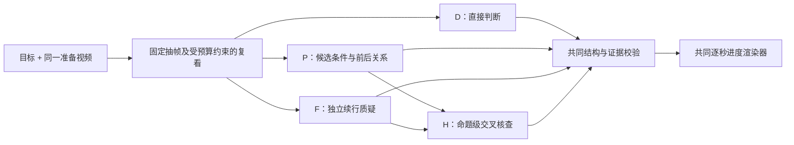

# 隐含前置条件 Monitor：可执行架构与比较协议 v2

日期：2026-10-05。状态：**预服务器设计，不是已验证或已选定的架构**。本文件细化[研究计划](2026-10-05-causal-prerequisite-monitor-research-plan.md)和[初版候选](2026-10-05-causal-prerequisite-monitor-design.md)，保留 D、P、F、H 四路线，不能预设 H 胜出。旧六段和已评分六族只能调试/开发；全新完整配对集须在方法、预算、判读规则冻结后制样。

## 1. 被监控的量与可声称的结论

输入仅为最终目标文字 `g` 和一条 15 秒准备动作 RGB 主视角视频 `v[0:14]`；可重看、放大或裁剪**同一视频**。输出每秒证据约束的进度，以及事件的关系前后状态、证据帧、备选解释和未知理由。模型不知道固定续行控制器，不应声称预测真实 `C=q_action-q_control`；`C` 只在模型原始输出封存后作为测试真值。视频若只显示“物体移动”，不等于“前置条件解除”。

把三个量分开存放：

1. **可见状态**：目标物、目标位置、候选前置关系是否满足，`s_j(t)∈{true,false,unknown}`。统一令 `true` 表示“目标所需条件已满足”，避免占位真假方向混乱。
2. **目标相关性**：这条关系为何可能限制后续目标？是否存在不经该位置/路径的合理替代？这只是视频支持的续行判断，不是假想成功视频或概率。
3. **进度**：主结果为准备事件的有符号增量/排序及每秒证据索引。数值索引不是工作完成百分比或成功概率，置信度也不是 `C`。

优先检验：同初态同指令下 `Δ(B+)>Δ(B0)`、`Δ(B+)>Δ(U0)`、`Δ(H−)<Δ(N0)`，并要求 `G+>N0`；正确/错/弃答/运行失败分别计数。仅有正向排序而证据无效，不算解释成功。

## 2. 候选架构：观察、归因、渲染分离



- **D1**：直接从目标和视频判断每个准备事件的方向/时间/证据；输出与其余方法相同的字段，但提示不强制先检前置或作反事实。不能把 D 写成故意简陋的“只给数字”。
- **P**：由目标和首帧自动提出本事件**一个最关键**的“完成目标前需满足的可见关系”；给前/后真假与帧证据。若还存在第二个独立阻碍而本次视频不能同时判断，必须在替代解释中说明并降为 `unknown`，不将单条关系解除误称全局可行。不硬编码红块、绿盘或六类标签。
- **F**：在独立上下文只看目标与相同视频，比较动作前/后的续行难易；至少尝试提出“原本也能完成”与“移动后仍被挡”两种反驳，并指出支持或无法排除它们的帧。若必须知道机器人路径/夹爪几何而画面不足，弃答。它不能读取 P 的输出，否则所谓独立质疑失效。
- **H0（当前可运行消融）**：程序仅核查 P/F 的结构、目标完成状态、前后真假与方向是否一致；一致时也只记为「待证据审核的结构一致」，不自动宣称两者指向同一物理关系或已排除替代路线。其逐秒曲线采用两者事件时间窗的并集，窗内保留未知；两者冲突或任一无效则弃答且不生成确定曲线。真正的**命题级 H** 需要可复核的关系对齐及替代路线审核，目前尚未实现，不能将 H0 结果冒称为它。直接目标已完成仍须满足下述可见转变校验。

**H 相对 ARS 的唯一待验证增量**：ARS 已覆盖事件提议、独立复看、事件核查、有用准备有限分、退步和不确定性；H 额外要求把“状态变化”与“目标续行可行性变化”分列，并主动搜寻不变/替代解释。CoINS 已在导航中做移障必要性的反事实判断，PRIMO R1/ProcVLM/R²VLM 已做目标条件步骤推理。因此本文件不宣称这些组件新颖；只有新配对实验支持、且 D2/强基线未解决时，才可讨论该组合在本窄场景的经验增益。

## 3. 输出契约与硬校验

每次 VLM **只生成短事件记录**，不生成 15 个数字；避免本地 2B 的 16 点列表和 `status`/曲线互相矛盾。事件记录示例：

```json
{
  "goal_before_complete": "true|false|unknown",
  "goal_observed_complete": "true|false|unknown",
  "relation": "goal-relevant visible condition in plain language",
  "before_satisfied": "true|false|unknown",
  "after_satisfied": "true|false|unknown",
  "comparison": "better|same|worse|unknown",
  "event_interval_s": [6, 9],
  "evidence": [
    {"second": 3, "region": "natural-language region or pixel box", "supports": "one visible claim"},
    {"second": 14, "region": "...", "supports": "one visible claim"}
  ],
  "alternative_route": "specific alternative or unknown",
  "disconfirming_observation": "specific visible challenge or unobservable",
  "uncertainty_reason": "... or null"
}
```

所有方法用同一外层 JSON、解析器、视频帧清单和事后进度渲染器。`D` 可以填这些字段但不受 P/F 推理次序约束。无效枚举、非已提供帧索引、越界区域、时间倒置或缺字段标 `invalid`，保留原文；不能截断多余数值、默默补帧、以失败当零。结构校验只能检字段，**不能证明图像解释正确**。单独审阅证据帧是否真的显示所称对象/关系，并报告观察者数和一致性；目前只有一名复核者时不称独立盲审。

解析有效和语义自洽分开：例如 `before_satisfied=true, after_satisfied=true, comparison=better` 在没有其他可见关系变化的解释时标 `self_contradiction`，不能由渲染器照单加分；`false→true` 却引用不到动作后帧则标 `unsupported_transition`。这些记录仍保留在总分母，且不能用事后真值自动修正。

G+ 锚点以“目标起初未完成、视频内直接完成”为制样条件；`goal_before_complete` 与 `goal_observed_complete` 分别描述**最终目标本身**在首末帧的真假，和自由选择的前置关系 `before_satisfied/after_satisfied` 分开。目标 `false→true` 才给直接完成的正向，`true→true` 无新完成进度，首帧未知则不确定；目标直接完成时，另一个可见前置关系可能全程不变，不能误判为矛盾。一次本地 2B 烟测把“蓝块不在盘里”写成“目标已完成”，这类视觉真伪仍须人工证据核验；结构约束只能抓显式自相矛盾，不能证明图像理解正确。

进度渲染器只读已验的事件记录，不读真值：`p_t` 为 0–100 的**证据进度索引**。预选纯准备权重 `α=0.25`：目标明确未完成时，本事件唯一候选前置关系已满足则为25、未满足则为0；一旦明确看到目标完成，记100。单条条件由 `false→true` 得 `0→25`，`false→false` 得 `0→0`，`true→true` 得 `25→25`，`true→false` 得 `25→0`；G+ 终态为100。若最终目标完成与否是 `unknown`，不输出确定点，给包含潜在完成状态的上下界；无效模型输出或 H0 弃答仍输出 15 个 `point=null`、`[0,100]` 的明确未知点。如果一个关系不足以代表可见准备（例如另有独立阻碍），则输出上下界与 `point=null`，不人为平均；事件时间仅能定位在所见两帧之间时，区间内秒点保留未知/上下界，稳定前后秒点可给确定值。`α` 不是学习参数，也不拟合旧真值；报告 `α∈{0.10,0.25,0.40}` 的排序敏感性，主比较看方向和关系真值，绝不把该索引叫成功率或完成百分比。若该数值化不能反映不同新机制的进度，保留关系/事件方向为主结果，把绝对曲线降为探索性输出。

## 4. 模型输入与公平预算

固定桌面、主视角 640×480、15 张 1 FPS 输入；以编号视频和目标为唯一外部输入。主比较为**离线回顾**：允许看整段准备视频再给每秒曲线，但不得看准备视频之后的任何画面。同一视频内部的未来帧可用于回顾，报告中必须写明这不是在线前缀因果推理。另做前缀敏感性：在 t=2、9、14 各只提供 `v[0:t]`，不得用整段回答冒称实时输出。TOPReward 原生逐前缀与本方法回顾设置的权限差异单列。

第一层所有方法固定取 `0,2,4,6,8,10,12,14` 八帧，按原比例处理；第二层在相同**上限**内可从同视频重看至多四个时间点或等面积裁剪。主消融先禁自适应重看，以免选择策略成为隐含优势；自适应作为另列试验，选择算法和预算给 D2 同样使用。存每次实际帧索引、原视频/解码像素哈希、裁剪坐标、像素数和模型视觉 token。主同预算配对：H=P 一次＋独立 F 一次；D2=直接一次＋独立直接复核一次；两者同骨干、同输入帧数与分辨率、同上下文轮次和相同最大生成 token（初拟各 512）。P/F 单问和 D1 作为低成本曲线点。比较同时报**实际**视觉 token、文本 token、时延、峰值显存、解析率和弃答率；若实际预算差距明显，不能仅因“都是两次调用”说已严格匹配，须做预算受限重复或标不可比。

评分前冻结全部方法的提示、顺序、解析和后处理。为检验 F 是否只是重复 P：比较 F 独立输出的具体替代路线和 P 的候选关系，统计非同义的新反驳；交换 F 的“前后”问序和一次同义措辞版本，若符号大幅改变，F 不能作可靠独立核查。

### 待接口烟测的提示文本（共同字段，未用结果调参）

共同前缀：

```text
You are reviewing an offline preparation video for a fixed tabletop robot task.
The only task information is the final goal: {instruction}.
Use only the supplied frames from this video. Do not claim to have seen a
continuation, a simulator state, or an exact future success probability.
"Satisfied" means the visible condition needed for the final goal appears
to hold, not merely that an object moved. Cite only supplied frame seconds.
Set goal_before_complete from the first frame and goal_observed_complete from
the last frame. Use "true" only when the final goal fully visibly achieved its
described end state at that time. If a required end-state relation is visibly
false, use "false"; do not mark a preparatory condition as goal completion.
Keep goal completion separate from the chosen prerequisite relation.
For goal_before_complete, goal_observed_complete, before_satisfied and
after_satisfied, write exactly "true", "false", or "unknown".
Never put descriptions in these enum fields; put explanations in relation or evidence.
If the view cannot resolve object identity, occupancy, or an alternative route,
use "unknown" and say what is missing. Return one JSON object in the shared
event schema; do not emit a per-frame number list. Cite exactly two evidence
entries, one before and one after the event interval. Each supports value is
a short string; use no extra keys and keep free text under 20 words.
```

单次指令尾部：

| 方法 | 追加的任务文字 |
| --- | --- |
| D1 | `Directly assess whether the observed action made progress toward the final goal, had no supported effect, or hindered it. Fill the event record with visible before/after evidence and any uncertainty.` |
| P | `Choose the single most decisive visible condition that the final goal may require. Prioritize whether the observed action changes an obstacle or affordance for the remaining goal. Do not choose a static fact merely because the goal mentions that object. If the action changes no goal-relevant condition, report same. Describe the chosen condition before and after using cited frames. Mention any other independent blocker you cannot inspect.` |
| F | `Independently compare continuing the final goal from the scene before and after this action. Try to disprove an apparent improvement: could the goal already have been achievable before, or could a blocker remain afterward? Name a concrete alternative route if visible; otherwise say unknown. Base the comparison on cited frames.` |
| D2 第二次 | `Review the previous direct event record below against the same supplied frames. Correct any visual or logical mistake; preserve uncertainty where evidence is insufficient. Return the same event schema. Previous record: {raw_D1}` |

H0 **没有第五段 VLM 提示**：它对 P 与独立 F 的原始短事件记录做结构合并，输出必须带 `requires_evidence_audit=true`。它目前不做语义关系对齐；若两者同错，H0 也会错。若 8B 输出格式仍不可靠，应先对**全部方法**统一使用同一种约束解码或短字段协议，升版本并在所有开发例重跑，不只修 H0。

## 5. 三个可手算例与失败预期

| 可见关系 | P 必须观察 | F 必须挑战 | H/渲染预期 |
| --- | --- | --- | --- |
| 旧开发 B+：红块从唯一可放置区域移出 | “放置区域可用” `false→true`，证据至少含动作前与稳定后 | 是否本来还有别的位置？视频能否支持唯一占位？ | 充分支持时正向有限信用；不能确认容量则 uncertain |
| 旧开发 B0：红块被移动但仍占位 | `false→false`，不可凭移动认作解除 | 移动后是否仍挡目标放置？ | 零；若两个方法给正向则记录感知/归因错例 |
| 旧开发 H−：红块移入目标位 | `true→false` | 是否使目标更难，或蓝块可从旁绕过？ | 证据充分则负向；不能排除替代则 uncertain |

U0 初态已可用，前后应 `true→true` 且零增量；G+ 蓝块真的进入目标位要给 100；N0 静止保持平坦。抓取入口若从单主视角看不清实际夹爪路径，应坦白未知；不能从评测用物理续行结果反填模型判断。

## 6. 强基线、服务器资源与运行顺序

[既有执行记录](../../reports/prerequisite_probe_phase1_20261004.md)证实此前 SeetaCloud RTX 5090 **32 GB** 上已有并跑过：Qwen3-VL-8B-Instruct 固定 revision `0c351dd01ed87e9c1b53cbc748cba10e6187ff3b`，用于 TOPReward 官方入口；Robometer-4B 固定 revision `beef63bc914c5c189329d49c6d712d96d632aa34` 和 Qwen3-VL-4B 基座，用 PR #33 dtype 兼容版成功推理。严格未改 Robometer 原版因 dtype 报错无分数。[2026-10-05 00:04 的旧状态](../../experiments/prerequisite_probe/artifacts/unseen_run_status.json)称该实例当时可达、GPU 空闲；**现在可达性及权重留存未知**。本机完整可运行的只有 Qwen3-VL-2B，旧 8B 本地缓存仅有第四片，不能拿它代替服务器 8B。

未来服务器阶段以**已存在的 8B 权重**跑 D1/D2/P/F/H，才能做同骨干差异；TOPReward 8B 原生分数和 Robometer-4B 兼容版是另外两条已训练/不同输出语义基线，不能把 Robometer 当 P/F/H 的同骨干控制。ProcVLM、PRIMO R1、R²VLM 是更接近的强方法，但现有云机**尚未核实**有其专用权重；不重下/新买来凑基线，缺权重就列“未运行”。ARS 官方源码不可访问时仍列“未运行 ARS”。

运行顺序：先完成本地文献/代码及低成本诊断与本设计冻结；随后全新两种质不同机制、每机制完整 B+/B0/U0/H−/G+/N0 物理制样与输入哈希冻结。仅届时检查既有租机的 SSH、剩余时长、GPU、磁盘、旧权重、依赖；用**旧开发视频**做一段格式 smoke，不能让新测试标签反馈改提示。若 smoke 未过，保存失败并停止/修通用接口，方法版本升级后新测试仍不可窥分。通过后按完整机制批次跑、立即保存原文/调用成本/失败、取回核哈希，再开真值评分。是否先在云机对全部旧开发材料做 8B 比较，须在新测试输出前固定版本与选择规则；旧开发成绩不报泛化。

### 全新机制的制样候选（仅物理设计，不是已冻结样本）

| 机制 | 与旧族区别 | 六类脚本的关键可见状态 | 制样前的排除门槛 |
| --- | --- | --- | --- |
| **托盘口横杆**（物理 20 种子通过；视频待核）：可移走横杆横跨落点上方 | 旧占位族用红方块填满目标容器；此处是下降路径的上方阻挡 | B+ 横杆移开；B0 挪动后仍覆盖落点；U0 原本移开、做无关移动；H− 横杆移回；G+ 放蓝块；N0 静止 | 后续固定控制器须给 B+ 正、B0/U0 零、H− 负；主视角须看清杆与托盘口 |
| **源物体上方支架横梁**（物理 20 种子通过；视频待核）：横梁由两柱支撑于蓝块上方 | 旧抓取入口族是蓝块旁侧通道；此处妨碍从**上方接近源物体** | B+ 横梁移开；B0 挪动后仍在上方；U0 原本移开、做无关移动；H− 横梁移回；G+/N0 作锚点 | 同上四方向；主视角必须辨认蓝块及上方横梁，不可依赖仿真状态代替图像 |

早期 **source_stack 叠压蓝块**候选已按 3 种子物理筛选排除：四条件及对照后续全成功，`C=0`；原始记录在 `research/prerequisite_monitor/development/new_scene_trials/source_stack_trial.jsonl`。上述两项均从全新场景配置制样，绝不将旧六族改名。它们已按固定控制器通过 20 个同种子扰动的四方向物理初筛；下一关仍须审查完整六段的主视角可见性、同初态、等时长、实际解码和原协议阈值，然后才能冻结。所有失败尝试及排除原因留档；不能用模型得分筛场景。

## 7. 提前写定的推翻条件

- 若 D2 或可运行专用强方法在新机制配对上达到同等排序、覆盖率和证据有效率，H 没有可主张的增量；优先简单或已有方法。
- 若 P 或 F 单独同样正确而更省预算，不选择 H；若 H 的优势只来自更多帧/token 或弃答，否证 H。
- 若 P 关系 `false/true` 在可见场景仍错，归因前先解决感知；若关系正确而 F 续行判断错，归因于反事实质疑；若两者正确而曲线错，归因于渲染器。不能把所有错归为“模型不懂因果”。
- 若视觉无法判断必要关系，合理未知会压低覆盖率；不以仿真真值逼迫猜测。若两种新机制无法制成完整物理有效配对，停止盲测宣称。
- 若 ARS 官方原版后来可跑且在新完整配对中正确，不声称其不足或以手写近似版替代。

下一步唯一入口：**离线核对这份输出/预算合同与现有 8B 推理环境兼容性，冻结通用解析和盲测制样规格**；服务器可在之后的既有实例验证阶段开启。未解决反例：单目视频或无法断定“替代路线不存在”；同样的结构化输出也可能让 D2 足够正确。
