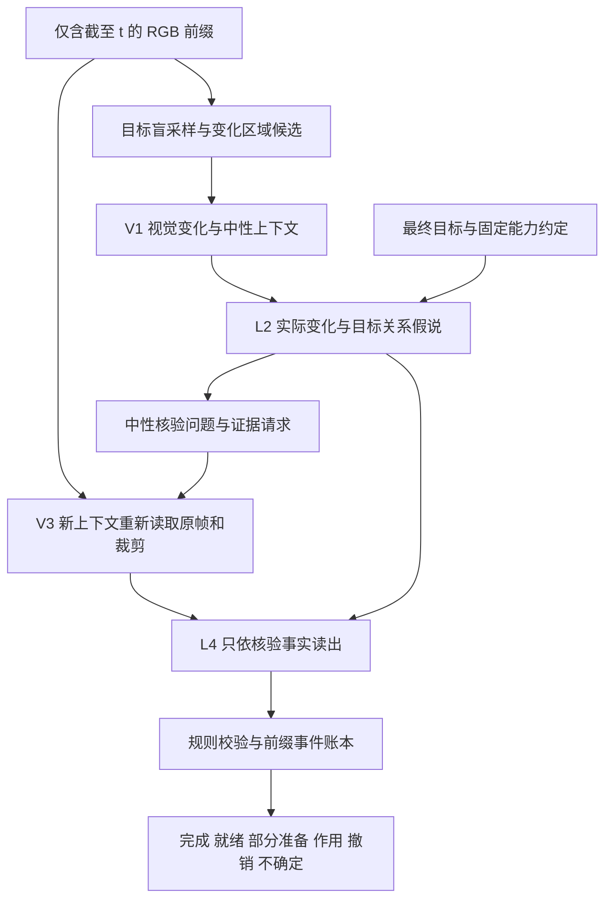

# 变化先行的桌面操作进退 Monitor：架构蓝图与验证合同

日期：2026-10-08（北京时间）  
版本：设计候选 v1.0；**可供审查，尚未实现、尚未开展新模型评测或策略训练。**  
最高约束：[最新变化先行冻结](../../research/prerequisite_monitor/CHANGE_FIRST_IDEA_FREEZE_20261008_zh.md)。继承[原研究冻结](../../research/prerequisite_monitor/RESEARCH_IDEA_FREEZE_20261008_zh.md)的任务与证据；此前[实施计划](2026-10-08-change-guided-task-knowledge-monitor-plan.md)和[架构备忘](2026-10-08-change-guided-architecture-design.md)中的具体实现只作候选。

本文中的“推荐”“应”“门槛”是下一阶段的设计决定或待冻结预注册建议，不表示用户已批准执行；“实测”仅指已有开发实验或本轮只读核查。本文不把信息流顺序、局部命题或独立核验称为已成立创新。

## 0. 推荐结论与阅读入口

推荐先研究一个**同底座、四次短调用、有限事件账本**的系统：

> 目标不可见的变化提取 → LLM 对实际变化提出目标关系假说 → 新上下文重新读取前缀像素并核验 → 基于核验结果读出任务进退。

第一版使用固定预算和共同取证包，先识别信息流本身的作用；通过后才做自适应追加取证和两调用压缩。四次调用是为了让感知、关系、核验和读出可分别检查，不是预设四次一定比一次准确。候选系统不训练任务专用奖励模型，不生成完整任务树，不把运动幅度、文本合理性或“尚未完成”直接映射成进度。

最重要的五项设计决定：

1. **变化发现阶段看不到目标。** 先保留小幅、局部和短暂但真实的变化，包括目标物运动；目标只在关系阶段进入。全画面采样是漏检保险，不能只看最大的运动框。
2. **关系假说有双重核验义务。** 一方面重新核对变化事实，另一方面核对它是否落在正确目标对象/区域、是否足够、是否仍有可见阻挡。物理必要性无法从单视角确认时不能硬判。
3. **状态、事件与历史分开。** 完成、直接就绪、部分准备分别记录；有利/有害是相邻状态间的事件作用，撤销必须引用过去已获得的具体成就，末态相同不等于没有发生进退。
4. **主比较拆成两个问题。** 共同感知与共同像素下比较直接读出、目标先行、变化先行，识别关系阶段的增量；再在相同资源上限下比较完整系统，测实际性价比。
5. **先给一个可以失败的研究计划。** 现有 A/B 只作开发回归；新左右目标交叉检验关系绑定；真正新布局、新机制封存后盲评；评价有增益后才用同一数据池、等训练预算验证策略效用。

审查路径：§1–2 核查依据；§3–8 审架构与接口；§9–12 审实验能否识别贡献；§13–15 审资源、阶段门与下游；§16–18 审假说、交付与来源。

## 1. 已核查材料及不能抹去的失败

### 1.1 本轮阅读与复核范围

已完整阅读两份冻结、两份旧计划、A/B 场景卡、成功谓词、场景续行路线代码、P0 报告、P4/P5/P6 诊断、v0.2 报告及失败记录，并检查旧提示/解析/调用流程、证据图谱、竞争假说和先前文献映射。另直接解析 v0.2 原始 JSONL、126 行完整文字曲线、84 行配对表及八份实际输入 manifest，共 72 条文字输入；查看 A/B 的 E、R、N 原始帧审读拼图。已有语义审读主要是 Codex AI 审读，**没有因此升级成独立双人审读**。

本轮只读重算保存在 [existing_evidence_audit.json](../../research/prerequisite_monitor/change_first_blueprint_20261008/existing_evidence_audit.json)，环境快照保存在 [local_preflight.json](../../research/prerequisite_monitor/change_first_blueprint_20261008/local_preflight.json)。这不是新推理成绩，也不是对所有历史文件重新验封的声明。

| 证据 | 核查结果 | 对蓝图的具体约束 |
|---|---|---|
| P0 原始 `analysis_p0.json` 与报告 | TOPReward 的 E 三对×两机制为 0/6；Robometer 的 B E 为 3/3、A E 为 1/3 | 保留强正例；不得写“现有方法都不能识别准备” |
| P6 | 表面标签 14/18，E/H 为 0/4 | 总准确率会被无变化多数类掩盖，关键作用分类单列 |
| P5 | 视觉输出仅 9/18 可解析，且有初末状态实错 | 小 schema、独立解析状态；格式通过不代表视觉真 |
| v0.2 主原答 | 162 调；133 valid、15 schema/evidence failure、14 direction conflict；各方向候选 E/H 仍 0/4 | 不再靠叠加抽象续行字段掩盖漏变化；读出不重复要求模型给互相冲突的标签 |
| 自动关系/反主张文字 | 实际 manifest 的 18 对逐案完全相同，全部回退；不能识别真假关系处理差异 | 新消融必须先验证处理差异实际存在，回退不伪装为消融成功 |
| 一般准备提醒、字符等长中性文字 | 各 E 5/6；字符等长不等于 token 等长 | 提示措辞、预算、关系内容必须分开控制 |
| 完成控制 | 人工 causal_fact 使 A 的 G 相对 N_o 失配；general_preparation 的 A G 绝对变化为负 | 正确完成必须同时测绝对标签、召回与误报，不能仅看相对排序 |
| 历史成本 | 1,588.371 秒模型时间；388,482 输入/54,785 输出 token；峰值已分配显存 17.0859 GiB | 只作成本初始参照；不能等同新架构速度或显卡全部占用 |

### 1.2 场景物理含义与可见含义

来源：[A 卡](../../research/prerequisite_monitor/fresh_scenes_20261006/scene_cards/access_gate.md)、[B 卡](../../research/prerequisite_monitor/fresh_scenes_20261006/scene_cards/support_surface.md)、[contract.py](../../experiments/prerequisite_probe/fresh_prerequisite/contract.py)、[routes.py](../../experiments/prerequisite_probe/fresh_prerequisite/routes.py)。

- A 的蓝块边长 46 mm，部分开口为 30 mm，完整顶孔 110 mm。评分侧的尺寸可支持“不足以通过”的几何判断；**模型不得收到这些精确尺寸**。盒内完成后关盖不必破坏目标：完成谓词不直接检查盖的位置。
- B 的黄色板滑到高位标记足迹；绿色标记和灰色导轨不能简单当作中央承托面。板只前移 30 mm 的 S 仍不到目标区；但“没有直接就绪”不自动等于“没有任何部分准备”。
- 完成真值要求足迹、底面高度、正确接触、夹爪释放、低速度和至少 0.5 秒稳定窗口；RGB 模型只能确认可见外观及持续性，不能直接读接触冲量或证明承重能力。
- 现有 E/H/R 等结构运动由预设运动学位置加同步机器人路线驱动；G 的蓝块抓放另有动态过程。现有续行只有有限路线/种子，不能据此宣称所有策略的可达性，也不能直接训练并证明机器人学会主动开盖/推板。
- 旧 1 FPS 输入是 15 个采样帧。其 R 变化在中段，单纯首末差会漏掉；这些已知事件时间仅用于本轮审计，**不得变成新检测器的专用时间表**。

旧证据保留旧标签。尤其旧 S 被归入 unchanged 的合同与本文“部分准备”新合同不同，不能偷偷重标旧结果，再声称历史方法变好或变差。

## 2. VICtoR、ARS 的准确比较与定位

### 2.1 两篇主参考对应什么

| 维度 | VICtoR | ARS | 本蓝图的候选选择 |
|---|---|---|---|
| 任务知识/事件入口 | GPT-4 用任务、给定对象/状态/动作集合和初始环境生成阶段知识 | 任务条件下提出事件时间线 | 先目标盲的变化，再局部目标关系 |
| 视觉环节 | 对象检测/裁剪、训练的状态分类与 motion progress evaluator | 自适应取帧/裁剪，另一上下文核验事件 | 小型固定证据包起步；独立核验重新读像素 |
| 训练 | 动作级视频及状态监督训练视觉奖励组件 | 不新增奖励模型训练，主实验使用 Qwen3.6-27B | 首轮共享已有 8B 底座，免新增专用训练 |
| 时间边界 | 当前视觉状态匹配阶段并构造势能变化奖励 | 离线全轨迹；明确允许未来证据核验过去 | 严格 `≤t`，保留历史输出快照 |
| 输出与学习用途 | 分层进度/奖励，用于策略学习 | 事件、进度，及进度差动作块筛选 | 多维状态/作用先行，效用另证 |
| 特权与额外信息 | 给定词表；模拟策略实验使用真值检测器加速 | 终局标签、参考示例等是另列可选配置 | 主结果全部禁用；oracle 单列 |

VICtoR 的定位依据为 [v2 §4、§5.1、附录 G](https://arxiv.org/html/2405.16545v2)；ARS 的定位依据为 [v1 §3、附录 A/F](https://arxiv.org/html/2609.34484v1)。VICtoR 不能简化成手工写死全部步骤；ARS 已包含准备、部分成就、退步和独立取证，不能写成只会完成评分。

### 2.2 对设计有约束的差别

**与 VICtoR 比较的是“生成什么知识、由什么触发”。** 本文不需要先产生全阶段序列，也不把阶段号当通用进度。VICtoR 的视觉状态与动作进度学习同样重要；只复刻 GPT 提示不能称复现 VICtoR。给终态目标而删掉原任务中明示的准备步骤，是任务协议变更。其方法可在当前观测上产生奖励，不能把“前缀因果”本身说成首次提出。

**与 ARS 比较的是“先看变化是否值得、是否严格前缀、怎样少量取证”。** ARS 已有非常接近的事件核验路径。我们需要测目标盲变化发现和局部关系约束的独立收益；仅把它改成前缀或者换成四次调用不构成有效性/新颖性证据。ARS 的工作流消融不是严格同实际 token；附录 F.2 的短视频各变体接近，也提醒我们复杂核验可能没有收益。其长轨迹完整流程平均约 24.9 次模型请求，不能把本文的四调用预算称为原版 ARS 的成本。[ARS 附录 F.2](https://arxiv.org/html/2609.34484v1#A6.SS2)

**代码现况，2026-10-08 重新检查：**[VICtoR 仓库](https://github.com/cmlab-victor/victor-code)当前根目录只有 LICENSE 和 README，后者说明资源尚在整理；[ARS 论文链接仓库](https://github.com/midea-ai/ars)在本次网页访问失败，GitHub API 返回 404。404 不能区分尚未公开、不可访问或地址问题。两者均不能声称已有可执行官方复现。本项目将目标先行基线命名为“VICtoR 启发的受限信息适配”，ARS 对照命名为“依据论文重建的 ARS-prefix”，并列出偏离。

### 2.3 辅助文献只用于校准边界

[ReSET](https://arxiv.org/html/2509.18043v1)学习主动重整初态后切换基础任务策略；它提示准备有控制价值，但与当前评价既成行为不同。[SOLE-R1](https://arxiv.org/html/2603.28730v2)通过训练从目标和视频前缀预测进度，是训练型竞争路线；不能把前缀、退步或视频语言推理说成此项目独有。

本文的合理研究主张至多是待检验的组合命题：“在最终目标、单 RGB 前缀、固定预算条件下，先观察实际变化再提出并视觉核验局部关系，改善准备、错目标、撤销判断。”它不等同于已证明因果关系、一般可达性或最优任务进度。

## 3. 精确问题、时间边界与输出合同

### 3.1 合法输入及能力约定

输入 `X_t=(g, RGB[0:t], A)`。`g` 为最终目标原文；`A` 为所有测试共用的能力约定：单臂可以接近、抓取、搬运、释放目标物，能与可见可操作结构交互，但不能穿透刚体、瞬移或改变物体大小；具体可达性、抓稳、隐藏锁定仍需证据。不得提供逐场景技能成功表。

“直接就绪”的操作定义：目标尚未完成时，在保持**目标物之外的环境结构当前状态**不变的条件下，存在符合固定技能类的目标物操作可完成目标，且可见证据足以支持这一判断。机器人还没靠近目标物不等于未就绪；仍可继续开盖后完成，也不等于当前直接就绪。该量只对约定技能类成立，不声称任意控制器的全局可达性。

### 3.2 前缀防泄漏的实现合同（待实现）

1. 推理进程仅能拿到经隔离的前缀帧服务；没有原完整视频路径、未来长度、真值、条件名、评分器、成功示范或后验摘要权限。文件名匿名化，A/B、E/H 等不进入模型。
2. 每个证据句都关联 `frame_id/time_s/crop_xyxy/pixel_hash/access_phase/as_of_t`。坐标归一化到原图；裁剪重缩放另存变换。技术元数据仅含当前可用时间戳、分辨率、采样率。
3. 稳定帧必须用到达 `t` 前的窗口；禁止以 `t` 后的机器人离开、目标落稳决定 `t` 时刻抽哪帧。离线切分也不得先读完整视频找全局峰值，再截断。
4. 模型缓存按 `video_prefix_hash + g_hash + protocol_hash + as_of_t + arm` 隔离；不同目标只可共享未经目标条件化的确定性像素变换。带目标判断的记忆不得跨目标复用。
5. 从 `t+Δ` 新获得的证据可生成新版本事件，记 `observed_interval` 与 `confirmed_at=t+Δ`；过去 `ŷ_t` 不改写。现在发现过去确曾发生变化，是延迟确认，不是当时已正确识别。
6. 去掉视频尾段、拼接任意尾段、置换未来标签，`ŷ_t` 及其访问日志必须相同；固定 `g,RGB[0:t]` 时仅改未来不得改变抽帧、缓存或读出。模型所有请求都校验 `max(frame_time)≤t`。

**首轮查询模式明确固定：**主机制实验使用无跨查询语义记忆的前缀重建；每个查询从合法前缀重新提取变化，L4只收到本次前缀内重建的临时事件表。持久账本用于归档和匹配事件，不把此前模型判断当事实传入下一查询。这样四调预算不会藏着历史模型调用，不会把记忆误差混进信息流比较。S的稳定状态如需复用，只能复用目标盲且由同前缀确定的CPU状态。带语义账本的流式部署是单独消融，三臂获得相同记忆额度，整个序列的累计成本和过去快照均记账。

每次输出包括截至t新确认的事件及其原观察区间；`net_effect`的参照固定为该视频最早可用初态，不能一会儿比较前一帧、一会儿比较初帧。局部作用另注明事件区间。V3共同证据包必须覆盖基准初态、当前状态及被评事件的前后；预算不足则净作用unknown。延迟确认的过去事件仅计入当前查询的已知历史，过去查询仍按当时输出计分。

### 3.3 输出不强压成一个百分数

| 字段 | 值域及含义 | 不允许的替代解释 |
|---|---|---|
| `goal_done` | true / false / unknown；当前可见完成证据 | 不是“准备结束” |
| `direct_ready` | true / false / unknown / not_applicable；已完成时为 not_applicable | 不是“未来继续准备总能完成” |
| `partial_preparation` | true / false / unknown / not_applicable；已建立部分有用条件，但尚未就绪；完成时不适用 | 不是运动了某个距离就为 true |
| `impact` | beneficial / harmful / irrelevant / mixed / unknown；此次事件或指定时间区间的目标作用 | 不是初末状态的简单绝对值 |
| `net_effect` | beneficial / harmful / unchanged / mixed / unknown；当前与基准前缀状态相比 | R 回原状态时是 unchanged，不能称全过程无关 |
| `reversal` | true / false / unknown + 被撤销事件/成就 ID | H 从已开放初态关闭可能有害，但若没有此前获得事件，不自动称历史撤销 |
| `completeness` | complete / overflow / occluded / no_observable_change | 无检测不等于真实世界绝无变化 |
| `uncertainty` | 有具体缺失证据及原因代码 | 不用虚构的精确概率装饰答案 |

`goal_done=true` 优先决定面向用户的“已完成”，但保留同期无关或有害事件，不把“完成优先”实现成把所有其他错误吞掉。准备状态不能凭空盖过可见完成；完成也不是吸收态，后来目标被拿走可变 false。

首版不输出通用 `progress=0.63`。能确认的偏序（例如同案 blocked→partial→ready→done）可用于特定受控比较，不能跨不同剩余工作量强行排成一条标尺。

## 4. 架构备选及选择依据

| 方案 | 结构与调用 | 优点 | 风险与取舍 |
|---|---|---|---|
| A：两调用压缩 | CPU 候选→一次 VLM 内先变化后关系→一次新上下文视觉核验及读出 | 便宜，可作为后期部署候选 | 第一次调用已看到目标，无法硬保证“发现时目标盲”；核验与价值读出易互相迎合，不适合首轮因果归因 |
| **B：四调用可审计版，推荐** | V1 目标盲变化/上下文→L2 局部关系→V3 像素复核→L4 受约束读出 | 数据边界能由服务端保证；接口短，能区分四类失败；同底座便于预算控制 | 多轮延迟，文本接口可能丢信息，共享权重仍有相关错误；必须接受直接法胜出 |
| C：视觉对象图/专用状态网络 | 追踪/分割→状态图→关系 LLM→视觉或几何验证 | 多对象长程绑定潜力大 | 新模型/训练、图错误累积、成本和隐式场景词表多；首轮不采用，只有明确绑定瓶颈才升级 |

纯首末像素差不是最终方案：会漏 R；纯光流会把机械臂遮挡当结构变化；直接用 VLM 全片描述已经在旧 V0 中失败。推荐 B 的变化提议是**目标盲的低成本时空候选 + 全帧时序 VLM 校验**。候选仅决定观察位置，不能写入“开盖”“有效支撑”等语义答案。

主版本 V1、L2、V3、L4 可共享同一 Qwen3-VL-8B-Instruct 权重；L2/L4 用文本输入，新建上下文。这里的 LLM 是同一多模态底座的语言推理调用，不是另加昂贵大模型。逻辑独立不意味着统计独立；“独立验证”只指上下文和证据获取独立。异构视觉验证器是后续消融，不是默认提升保证。

## 5. 推荐系统逐模块蓝图



### 5.1 模块输入、输出、失败行为

| 模块 | 输入 | 输出 | 失败时如何继续 |
|---|---|---|---|
| P：前缀守卫 | RGB 流、当前时钟、匿名 ID | 只读帧句柄、允许时间集合 | 越界请求直接拒绝并计协议错误 |
| S：目标盲候选器 | 前缀像素和过去已固定的采样状态 | 候选区域/时间窗、相机扰动标记、共同证据包 | 不稳定时保留全帧；不得借目标补找“应当存在”的变化 |
| V1：变化提取 | 全帧+候选局部前后帧；**不含 g/A 的任务语义** | 中性初态实体描述、最多 3 条变化、可见性和端点引用 | 空集合合法；不确定变化标候选，不当事实；overflow 显式报告 |
| L2：关系推理 | g、A、V1 中性上下文与实际变化 | 每变化至多 2 个竞争关系假说、可证伪视觉问题、局部目标绑定 | 没有变化则不生成准备假说；仍安排当前完成审查 |
| Q：请求约束器 | L2 的问题/区域请求、公共取证预算 | 合法核验问题、证据句柄列表 | 超预算不偷偷补调用；记未覆盖问题 |
| V3：视觉核验 | 新取原帧/裁剪、实体描述、中性问题、原目标用于完成审查 | 原子事实 true/false/unknown、像素引用、变化是否真实、当前目标证据 | 否决错误事实；遮挡/尺寸不明留 unknown；不输出奖励 |
| L4：关系读出 | g、A、核验事实、待检验关系、前缀账本摘要 | 已核验的关系作用、状态字段、撤销引用 | 不能添加新事实；若假说需要未查证新谓词，输出 unknown |
| R：确定性校验/账本 | L4 短 JSON、事实和事件索引 | 结构有效性、各字段可用性、事件快照、成本记录 | 局部字段失败局部作废，保留无依赖的完成判断；整个原答不覆写 |

### 5.2 S：变化切窗与区域候选

以下数值是**开发起点**，必须在开发集校准、盲测前锁定，不是物理定律。

1. 固定机位先在低分辨率帧上作亮度稳健的差分/背景配准，记录相邻帧差、相对历史稳定关键帧差以及连通区域。离线前缀输入先按最多 2 FPS 扫描；旧 1 FPS 数据不插值制造证据。所有 CPU 扫描与解码时间计成本。
2. 将持续两次可用观测、或短时出现后逆转的空间变化保留为候选。长时间机械臂运动不能把其它低运动区域挤出候选；每次保留至少一个全画面均匀时间覆盖通道。
3. 机械臂不使用人工分割真值。简单差分只标“有变化”，V1 再区分机器人自身姿态、短暂遮挡、环境变化和目标物控制变化。**不硬删除机器人区域**：抓起/放下目标物可能发生在那里。
4. 前后稳定关键帧是因果更新的状态：稳定至少跨越 0.5 秒且有至少两次观测为初始提议。2 FPS 下两帧间隔恰好 0.5 秒；1 FPS 下只能说明稀疏采样间未见明显变化，不能证明连续 0.5 秒动态稳定。
5. 同一对象前移再收回拆成两条方向相反的事件，或一个带中态的复合事件。候选来自相邻/关键帧变化，不只来自起点—末点差。前后帧仍被遮挡时可标 `open_event`，等待新前缀；不等待未来后追补当时答案。
6. 多区域按持续性、变化证据质量和空间多样性选最多 3 个；不是按目标相关性筛。超过则 `overflow`，保留被省略候选的数量与粗区域记录。本次覆盖不足时不能给整段全局“无关”。
7. 相机大幅移动时，不把整图差分当作环境变化。配准不可靠则 `camera_uncertain`，降级全帧 V1 或 unknown。外观/视角泛化要单独测，不承诺首版能处理任意手持视频。

**共同观察包初值：**V1 至多 8 张全帧（512×384）加 4 张局部（256×256）；V3 同样上限。V1 包含首帧、当前帧、因果均匀覆盖和自动变化前后锚点；V3 优先补变化前/中/后与当前稳定性证据，始终含当前全帧。若所有需求超过 8+4，按固定规则轮转、标缺口，不能人工挑正确框。

每个 crop 必须同时可定位回其全帧，框外环境决定关系时改用更大框或全帧。主机制比较使用 S 产生的**完全相同两包像素**；L2 可提出待查问题，但不得让 C 独占额外清晰像素。自适应取证的收益另在系统比较中测。

### 5.3 V1：只提实际可见变化

V1 给实体临时 ID 和中性描述，不声称分类器知道场景类型。事实按 `observed / uncertain` 标记；“黄色矩形沿两条条状物向后移动”可观察，“支撑已经建立”应留给 L2/V3。

同时输出少量首帧中性上下文：可见物体、区域、包含/相邻/遮挡外观。它让 K 基线有同样的可见初态，并让 L2 绑定目标，不靠隐藏物体清单。最多 6 个场景实体槽，超出记截断。L2 不被迫认为 V1 的每句话都正确，V3 必须重新查关键事实。

无变化时仍检查当前完成与可见性：静止录像可能起始已完成，也可能始终未完成。若真实变化被 V1 漏掉，后面的完成分支只能如实报告状态，不能悄悄生成未经过“变化→关系→核验”的准备事件。

### 5.4 L2：LLM 关系判断的位置和最小义务

L2 是主科学变量，位于 V1 与 V3 之间。输入只含已经提出的变化、目标、可见上下文、通用能力，不含人工关系或正确裁剪。

每条关系至少回答：变化涉及哪个实体；它与目标哪个对象/终态关系有关；它可能改变什么局部条件；若属实是有利、有害、无关还是不充分；需要哪些可见事实；什么观察会否决解释。允许两个竞争命题，例如“覆盖目标足迹”与“只是投影重叠”，不强制制造一个有用解释。

局部问题可涉及原本不动的目标区，因为关系必须有参照；但它必须由某条已观察变化触发。不得借此扩展成“为了完成任务可能需要的十项条件”。全局完成判断检查的是用户目标本身，不是反向列准备清单。

### 5.5 V3：如何真正核验而不确认偏误

V3 新上下文不继承 V1/L2 的长解释，也看不到候选的有利/有害标签与确信程度。请求只带对象定位描述和中性问题，例如“该面在这些时刻相对于标记区域的覆盖如何？”而非“确认有效支撑已经建立”。问题身份仍可关联回命题，未宣称这种屏蔽消除了全部偏误。

核验分三层：

- **视觉事实：**同一实体的前后位置/形态、是否有真实持续变化、是否目标物与机器人遮挡混淆。
- **局部关系：**正确目标绑定、覆盖/开口/接触外观、残余间隙、目标足迹是否可见；每项 true/false/unknown。
- **当前目标状态：**用户目标的放置/包含、释放与持续静稳外观，独立于准备命题。必须保留 G 检查。

重新取证是重新从前缀源像素读取并记录本阶段访问，允许重新读同一帧，但不能把 V1 文本、差分热图或带答案的审读拼图当原像素证据。采到某时刻不代表该帧支持事实；证据 ID 校验只是必要条件，语义支持另审。

V3 可以发现漏掉的变化：主四调用层将其标 `new_unverified_change`，本轮不直接给有利信用。自适应六调用版本可再做一次局部关系与复核，或下一前缀处理；不得偷用未经核验的新关系。

### 5.6 L4/R：受约束读出与事件账本

L4 只读核验表。关系解释可以是推论，必须标 `inference` 并引用事实 ID；不能以常识补出隐藏锁、摩擦、接触或替代路线不存在。R 只查引用、类型、时间和一致性，不替 LLM 判断新的语义。

主输出不再额外要求一个与字段重复的 `direction`，避免旧 TP 的方向冲突。若模型仍生成矛盾字段，相关字段记 invalid，不能用“完成优先”偷修成全答正确。合法的 `goal_done` 可在准备分支失败时独立保存，报告整答有效率和字段有效率两种分母。

账本保留 `event_id, revision, observed_interval, proposed_at, confirmed_at, fact_ids, claim_id, current_status, reversed_event_ids`。同一实体同一状态转变合并去重，重复观察只刷新证据，不多给信用。恢复曾破坏的状态标 recovery；同一能力建立—撤销—恢复不等于三个净新成就。

多变化不能简单投票：一项帮助、一项损害且不可比较时输出 mixed，逐事件列作用；两个互补条件都只部分建立时不能各自宣布直接就绪；对象身份不稳时不强连撤销。初末相同但历史有获得又失去时，`net_effect=unchanged`、`reversal=true`，末个事件可为 harmful。

## 6. 提示词、结构合同与一条完整证据链

### 6.1 结构尽量由程序补齐，不让模型填写审计元数据

模型仅生成下列短载荷；系统自动补 `case_id/as_of_t/model_hash/prompt_hash/cost/pixel_hash`。未知采用字符串 `unknown`，真假亦统一字符串 `true/false`，不混布尔、字符串和 null。没有事件用空数组；不输出 `true/false` 这种候选串。主结果禁用事后人工 JSON 修复。

```text
V1Payload:
  initial_context: [{entity_id, description, region_id, visible_relation}]  # ≤6
  changes: [{change_id, entity_ids, before_refs, after_refs,
             before, after, observation: observed|uncertain,
             status: closed_event|open_event}]                           # ≤3
  coverage: complete|overflow|occluded|no_observable_change
  uncertainty: [{code, detail}]

L2Payload:
  claims: [{claim_id, change_ids, goal_binding, relation_hypothesis,
            possible_effect: beneficial|harmful|irrelevant|unknown,
            test_ids, falsifier}]                                       # 总计≤6
  tests: [{test_id, neutral_question, entity_ids, requested_refs}]        # 局部≤6
  # 全局 goal_done/direct_ready 的中性检查由共同模板追加，不靠准备假说触发

V3Payload:
  facts: [{test_id, at: before|after|current,
           value: true|false|unknown, evidence_refs, visible_statement}]
  change_checks: [{change_id, exists: true|false|unknown, evidence_refs}]
  goal_facts: [{criterion_id, value: true|false|unknown, evidence_refs}]
  new_unverified_changes: [{description, evidence_refs}]
  missing: [{test_id, reason: occlusion|identity|geometry|stability|
                           budget|out_of_prefix|not_observable}]

L4Payload:
  claim_results: [{claim_id, status: supported|refuted|unknown,
                   used_test_ids, short_reason}]
  events: [{change_ids, impact: beneficial|harmful|irrelevant|mixed|unknown,
            basis: observed|inference, fact_ids, reversed_event_ids}]
  state: {goal_done, direct_ready, partial_preparation}
  state_fact_ids: {goal_done: [fact_id], direct_ready: [fact_id],
                   partial_preparation: [fact_id]}
  net_effect: beneficial|harmful|unchanged|mixed|unknown
  reversal: true|false|unknown
  unresolved: [reason_code]
```

字段的限定和最小依赖要在实现时写入版本化 JSON Schema：`additionalProperties=false`、长度上限、枚举、证据引用集合和时间约束。证据 ID 用工具发放的有限集合，实体 ID 只在该视频前缀有效。自由文本限短句，不要求长思维链。结构化解码若可用，所有基线同样使用；若不可用，按同一严格 JSON 解析。不得把 unknown 当 schema error，也不得把 schema error 隐藏成自然 unknown。

**解析失败处理：**当前臂停止依赖该字段的后续推断；保留原答及错误码。固定四调用实验不额外重试，可以消费后续既定调用做格式纠正，但必须记录这一偏离并失去对应推理机会。实际部署另设最多一次修复调用的成本层，D/K/C 共享规则。不要重复旧 H3 的整条交集弃答：无依赖的完成证据仍可单独报告。

### 6.2 可直接供后续实现使用的提示模板（均为候选）

共享规则：

```text
You evaluate an already observed tabletop robot trajectory.
Use only supplied evidence with timestamps no later than AS_OF_T.
Visible facts, task-relation hypotheses, and verified conclusions are different.
Return only the specified JSON. Cite only provided evidence IDs.
Unknown is allowed when the evidence cannot decide; state the missing evidence.
Do not infer an event from the task instruction, elapsed time, or expected success.
Do not provide a complete action plan or a list of unobserved prerequisites.
```

V1 专用（不传目标，亦不传后续模板）：

```text
Describe what actually changed in the supplied chronological images.
First bind visible entities across time, then record up to three state changes.
Distinguish persistent scene changes, reversals, object control changes,
robot-only motion, camera motion, and temporary occlusion.
Do not infer purpose, usefulness, task completion, or physical necessity.
Keep a small neutral description of the first observed scene.
Candidate regions are search hints and can be wrong. Inspect full frames too.
Use an empty change list if no change is supported; report incomplete coverage.
OUTPUT: V1Payload.
```

L2 专用：

```text
FINAL_GOAL: {goal}
COMMON_CAPABILITIES: {capabilities}
PROVISIONAL_VISUAL_CONTEXT_AND_CHANGES: {V1_payload}
For each observed change, ask how THIS change could affect the final goal.
Generate at most two local competing claims per change, including no relevance
when appropriate. The visual description may be wrong.
Bind the changed entity to the intended goal object or destination.
Distinguish useful but insufficient preparation, direct readiness, damage,
and a final goal already achieved. Do not invent a task tree.
For each claim give a falsifier and a small set of neutral visual tests.
Do not infer hidden contact, load capacity, dimensions, or unique routes.
No claims about unobserved changes. Do not output a final reward.
OUTPUT: L2Payload.
```

V3 专用（系统不传 L2 的作用标签、确信度和解释）：

```text
You are checking fresh pixel evidence in a new context.
These neutral questions refer to provisional entity bindings; they may be wrong.
For each question report true, false, or unknown at the requested times.
Describe the specific visible evidence and cite newly supplied evidence IDs.
Check the changed entity, the intended target region, before/after direction,
remaining visible obstruction, and temporal persistence when observable.
Separately check the final goal's visible end-state requirements.
A missing observation is not proof of absence. A stationary image is not proof
of hidden mechanical support. Do not assign usefulness or progress here.
OUTPUT: V3Payload.
```

L4 专用：

```text
Read the goal, common capabilities, provisional claims, and verification table.
Use verified facts only. Claims are not evidence.
For every claim state supported, refuted, or unknown and cite the tested facts.
Report each change's effect and the current goal state separately.
An irrelevant change requires evidence about the goal relation; rejection of
one beneficial claim alone does not prove irrelevance.
Do not turn unknown into harmful or beneficial. If positive and negative
effects cannot be ordered, retain mixed and list both.
Mark reversal only when an earlier supported achievement of the same goal
relation is lost. Do not overwrite earlier prefix predictions.
No new visual claims and no invented continuous completion percentage.
OUTPUT: L4Payload.
```

所有臂共享“目标未动也可能有准备收益”“完成/就绪分离”“unknown 合法”等定义。不能只给 C 这些常识提醒，再将提示教学效应称为变化条件化增益。提示正式冻结前最多各臂相同轮数的开发修改；提示长度不硬填废话，报告真实 tokenizer 长度。

### 6.3 设计示例：同一板位移的证据链

**以下是人为构造的接口示例，不是此次运行结果，也不是由真值喂给正式模型的例子。**设 `t=14s`，目标为“把蓝块稳定放在标记高位区域”。证据服务已因果提供 `f02/f09/f12/f14` 及自动局部框 `r1`；实际执行才计算像素哈希。

V1 的候选：

```json
{
  "initial_context": [
    {"entity_id":"o1","description":"yellow rectangular surface","region_id":"r1","visible_relation":"in front of marked region"},
    {"entity_id":"o2","description":"blue cube","region_id":"r2","visible_relation":"on the table to the left"}
  ],
  "changes": [
    {"change_id":"e1","entity_ids":["o1"],"before_refs":["f02"],"after_refs":["f09","f12","f14"],"before":"surface in front of markings","after":"surface between markings and remains there","observation":"observed","status":"closed_event"}
  ],
  "coverage":"complete",
  "uncertainty":[]
}
```

L2 针对 e1 提议“移来的表面可能形成目标放置位置”，而非宣布已经建立机械承托。需要查：q1 同一块板是否确实覆盖目标足迹；q2 前后是否存在可见高度/边界错配；q3 是否在机器人离开后仍保持位置；另由共同模板检查蓝块仍在原处及目标是否完成。反例是板只停在目标旁、投影重叠但高度不对、仍由机器人扶着。

V3 的新证据可以是同一时刻的原分辨率重取，但有新访问编号，例如 `v3:f12:r1`：

| 核验项 | 示例答案 | 可支持的范围 |
|---|---|---|
| q1 目标足迹覆盖 | true，引用 f12/f14 全图与 r1 | 可见覆盖，非隐藏承重证明 |
| q2 高度和边界明显错配 | false，引用侧边轮廓与标记 | 未见明显错配；若轮廓不可见则 unknown |
| q3 机器人离开后位置保持 | true，引用 f12/f14 | 两个采样时刻保持，时序盲区仍记录 |
| g1 蓝块已在目标处 | false，引用 f14:r2 与全图 | `goal_done=false` |
| g2 目标物周围有可见抓取空间 | true，引用 f14:r2 与全图 | 只确认可见空间，不保证任意控制器抓取成功 |
| g3 可见运输/放置空间有明显阻挡 | false，引用 f12/f14全图 | 仅对共同可见技能合同；若关键区域不可见则unknown |

若这些证据已满足经双人审定的可见就绪合同，可给候选读出：

```json
{
  "claim_results":[{"claim_id":"h1","status":"supported","used_test_ids":["q1","q2","q3"],"short_reason":"visible target surface established under the common capability contract"}],
  "events":[{"change_ids":["e1"],"impact":"beneficial","basis":"inference","fact_ids":["q1","q2","q3"],"reversed_event_ids":[]}],
  "state":{"goal_done":"false","direct_ready":"true","partial_preparation":"false"},
  "state_fact_ids":{"goal_done":["g1"],"direct_ready":["q1","q2","q3","g2","g3"],"partial_preparation":["q1","q2","q3","g2","g3"]},
  "net_effect":"beneficial",
  "reversal":"false",
  "unresolved":[]
}
```

此true分支要求共同目标核验g2/g3同样充分，不能仅凭板的三个局部测试推导整个任务直接就绪。直接就绪在此只指共同可见技能合同，不是隐藏物理属性保证。若共同核验未完成，示例中的direct_ready应为unknown。

若 q2 由于遮挡而未知，并且这足以影响“可用放置面”的判断，h1、impact 和 direct_ready 必须相应 unknown，不能因 q1/q3 两票为真就接受。若只能证实“更接近但未覆盖”，partial_preparation 也要依据§8的独立标签合同，不能按像素位移自动 true。

同视频换成“放入左侧盒子”，e1 的 V1 内容必须保持一致；L2/V3 若证实板与盒口/目标物均不相干，才可判 irrelevant。若后续板收回，新 e2 核实损失相同放置条件，则 e2 harmful、引用 e1 作 reversal；历史 `t=14` 的 beneficial 仍保留，当前净效果可回到 unchanged。

## 7. 多变化、无变化与不确定性的显式规则

| 情况 | 正确处理 | 常见但禁止的捷径 |
|---|---|---|
| 同时开对盒、移动无关件 | 两条事件分别 beneficial/irrelevant；聚合有利但注明范围 | 把整个运动总量算进展 |
| 支撑到位但另一阻挡新增 | 分开记录；若无法比较整体作用为 mixed，direct_ready 可 false | 有利事件多就投票有利 |
| 两个条件都只做一部分 | 两条部分事实；整体尚未就绪 | 每个局部命题都“完成”所以目标完成 |
| 首末相同、中间开放又关闭 | 获得和撤销事件都保留；净状态 unchanged | 因首末差为零写无变化 |
| 初态已开放，后关闭 | harmful；若没有本前缀内的先前获得事件，reversal=false 或 unknown | 所有负向都叫撤销 |
| 完成后关盒盖 | 若目标仍成立，goal_done 维持 true；事件可能 irrelevant | 机械套用“盖关闭=退步” |
| 成功抓取被手臂遮挡 | pending/unknown，直到前缀出现可核验控制证据 | 用下一帧抬起回填过去成功 |
| 目标物持续搬运，端点还未稳 | 可记录有支持的搬运变化；完成 unknown/false 按证据 | 把“尚未稳定”当整个过程无用 |
| 没检出变化且当前清晰 | no_observable_change；核对当前目标状态 | 断言物理上没有任何变化 |
| 没检出变化且严重遮挡 | completeness=occluded、作用 unknown | 自动 irrelevant 获得负控高分 |
| 多于 3 条候选 | overflow；当前已核实事件可报告，但不作无遗漏保证 | 为控预算丢事件且声称完整 |
| 身份/投影歧义 | unknown，保留竞争绑定；同义/颜色不能替代身份追踪 | 把同色对象跨时强连 |

不确定性分为观察不足、实体绑定、物理推断、关系冲突、取证预算和输出故障。前五类是认知边界，最后一类是工程失败；报告时分开。置信度若加入，只用少量等级或开发集校准概率，不能把自报 0.95 当统计置信。

## 8. 标签合同：先保证“进退”可被审定

### 8.1 两层真值，不能让模型为不可见事实负责

每一视频—目标—前缀有两层标签：

- `physical_truth`：由仿真几何、接触、状态和固定续行得到；供制样和边界诊断。
- `visual_judgability` 与 `visual_reference`：两名未看模型输出的审读者只看**相同前缀**、同目标和能力约定，判断能否支持状态/作用。缺失的隐藏事实不由未来补齐。

主表包含全部预登记样本，不删除有争议病例；在可审定子集计算任务性能，同时报告其占全部样本比例，歧义集另测合理弃答/过度确信。审读者无法一致时交第三人裁决或保留 ambiguous。物理真值正确但视觉不足的样本，不把模型 unknown 算物理错；也不能用大量这类样本制造“可靠弃答”成绩。

### 8.2 标签操作定义

1. **goal_done**：终态成功谓词 + 当前前缀已拥有所需稳定窗口。窗口未满时不得借未来确认。视觉清楚的“尚在盒外”为 false；接触/释放不可判为 unknown。目标已达成后新损害仍可使其变 false。
2. **direct_ready**：按§3固定技能类，在不再改变环境结构条件下完成目标的可见可行性。评分侧用若干预登记直接续行路线和种子挑战；成功一条支持该路线下可行，多条失败仅证明这些控制器未成功，不能直接证明不可行。强 negative 需要几何排除或明确可见阻挡；否则标 unknown。
3. **partial_preparation**：确有目标相关准备条件改善，而直接就绪未达成。可用预登记可行准备路线的剩余工作量/控制步数下降、或已完成部分独立必要条件支撑；仅变近、移动方向相似、视频更晚不足以给该标签。即使位移 30 mm，若绕行/反向代价抵消也不一定有利。
4. **beneficial/harmful**：在声明的局部条件与技能类下，改变目标条件或准备工作量且方向可审定。局部几何关联是解释，不单凭观察声称干预因果效应。强因果标签需匹配状态干预后续行：除干预结构外保持其它状态/种子一致。
5. **irrelevant**：已有足够可见证据认为该变化不影响被声明目标关系；不是“没有发现有利”。不能排除未知关系时 unknown。
6. **reversal**：相同目标关系的已支持成就后来被撤销，必须有成就 ID、前后证据；全局净进展可能仍正。恢复损失单列 recovery，不与新收益混淆。
7. **mixed**：多条件利益冲突且没有预定可比较尺度；保留事件向量，不临时创造任意权重。

给制样侧的操作成本代理可写为 `W_A(s,g)`：**固定且有限的可行准备路线集合 A**中达到直接就绪所需剩余成本。它不是全局最优代价；路线集合和成本单位须先冻结。只在 `W_A(before)>W_A(after)>0` 且可见性支持时提供强部分准备标签；换目标后重新判断，不能沿用原目标 W。

### 8.3 审读和标签文件

评分侧保存：场景族、资产/布局/轨迹种子、同初态配对 ID、真实事件区间、每前缀物理状态、路线成功计数、是否可见、两名标注者原答、裁决、变更理由。推理侧仅有匿名目标和帧。

对新机制至少先做 10 个边界例的标签试审，目标是找歧义而非选择“模型容易的样本”。报告一致率及适合类别分布的 κ/α；大量低一致性则先收窄标签定义，不上模型填补。目标 0.8 一致性系数可作开发参考，稀有类下同时给逐类分歧，不能只凭单个系数过门。

## 9. 公平对照：信息流与观察策略分开测

### 9.1 主机制实验：共同感知、共同像素的 D4/K4/C4

同一底座、权重、量化精度、processor、解码、目标原句、能力文本、schema、两个公共证据包、四次调用与逐槽预算；所有臂调用 V1 得到**完全相同**的中性初态与变化包。这是受控关系读出实验，不冒称独立完整端到端方法比较。

| 调用槽 | D4：直接读出加复核 | K4：目标先行 | C4：变化先行 |
|---|---|---|---|
| 1，视觉 | 共同目标盲 V1 | 同左 | 同左 |
| 2，语言 | 根据目标与共同事实直接给暂定状态/作用及证据待查项，不构造前置图 | 只给目标+共同初态，生成至多 3 个目标条件；**看变化前封存** | 目标+共同初态+实际变化，生成局部可反驳关系 |
| 3，视觉 | 新上下文、共同核验像素；中性检查暂定判断 | 新上下文获得同样变化包与像素，对目标条件逐项核验 | 新上下文获得同样变化包与像素，对局部关系核验 |
| 4，语言 | 同一读出协议 | 同左 | 同左 |

K 在槽2暂时不能看变化是“目标先行”的实验处理，不是整个系统少给视频；槽3之前它已获得与其它臂相同的合法原始证据。它可以否决原条件，不能被迫满足错误阶段。V1 首帧上下文包含真实可见初态，不能故意让 K 在黑箱初态猜条件。

**强 K+ 对照必须保留：**槽2允许 K 看全部共同事实，仍按目标组织局部条件。若 K+≈C，仅 K4 被刻意延迟信息后较弱，则不能说 C 的关系形式有独立优势。**D4-direct 的完整系统对照**在第一次视觉调用就可看到目标并直接评估；其后同预算自检。若只赢共同 V1 的 D4，不能声称胜过最佳直接方法。

### 9.2 完整系统与成本前沿

- D1：目标+共同合法前缀一次直接判断，保留为低成本强参照；D2：两次有视觉的直接复核。
- D4-direct：两次视觉+两次语言的直接判断/自检，不要求局部关系模块。
- C2：压缩两调用；C4：推荐可审计版；C6：仅按冻结不确定性规则追加核验及读出，最多六调。
- K4/K+4 与 C4 使用同样取证权利。若自适应裁剪改变像素集合，在**系统实验**单列；共享访问许可与成本上限，报告实际不同输入。主机制实验仍锁共同像素。
- 比较质量—GPU秒、质量—视觉token、质量—覆盖率曲线；不为凑“同预算”让便宜方法无意义填充 token。上限匹配与实际成本匹配分别报告。若实际成本差超过 10%，需在邻近预算点插补/补跑，不能写严格等成本。

相同分辨率不一定相同视觉 token；tokenization 后核验实际计数。重复读取同帧、多轮复制上下文、失败/修复、CPU 候选器、最终读出都计费。共同 V1 为降低实验消耗可以缓存，但科学成本仍按每条臂独立运行收取一次，并另报真实总GPU消耗。

### 9.3 必要消融与 oracle

| 对照 | 要隔离的因素 | 必须防止的混淆 |
|---|---|---|
| C−relation：变化后直接读出 | 局部关系推理是否必要 | 总预算内把空出槽用于普通自检；同时报告自然成本 |
| C−verify：不重新看像素，只做文本复核 | 真正视觉核验的作用 | 另加同样像素的直接自检控制，拆分多看图与核验语义 |
| C same-context | 上下文分离 | 共享权重、同像素、同上限；完整历史带来的额外token计入 |
| 首末差 vs 时间关键帧 | R 检出是否源于时序覆盖 | 不把已知 7/8 秒写入检测器 |
| 无裁剪 vs 公共裁剪 | 空间分辨率/定位 | 给 D/K 同样裁剪，不能只优化 C |
| 目标/变化配对打乱 | 关系是否实际随目标和变化改变 | 真正检查输入不同，避免旧自动文字全回退 |
| 低成本普通提醒/同token近似中性提示 | 提示重定义或长度效应 | 目标语义不被改成“准备就算完成” |
| oracle变化、oracle框、oracle视觉事实、oracle关系分别注入 | 感知、绑定、关系瓶颈的诊断上限 | **额外输入**；不入主表、不并入正式方法 |

Oracle 依次只替换一层，还要记录下游错误；多个 oracle 全对仅为组合上界，不能用来宣称原系统效果。无核验版的输出与核验前后配对分析能给“纠正数”和“破坏数”，不能仅报告核验后精度。

### 9.4 外部方法的身份

TOPReward 原生、Robometer PR #33 dtype 兼容版保留历史回归；未来新数据重跑时固定身份，不能用历史成绩当新盲测。它们没有相同事件 schema，可用原生进度/完成头做共同目标指标及配对方向，证据解释项记不适用，不人为判失败。

ARS-prefix 以公开论文重建：任务条件事件提出→新上下文核验→进度；禁用未来、终局标签、示例和特权状态；限制每个前缀的请求预算，记录未完成与裁剪请求。原版全轨迹 ARS 若将来可用可作**额外信息离线上界**，不得与前缀成绩混表。VICtoR 启发适配只能测目标条件生成，未训练原视觉模块不称 VICtoR 复现。SOLE-R1 等仅在现有权重/环境/许可与预算明确后列新实验；未运行记 NR，绝不填 0。

## 10. 制样、交叉实验和真正未见泛化

### 10.1 先做能证伪关系绑定的左右交叉

新建对称双盒开发场景，蓝块不动；视频 vL 仅打开左盒，vR 仅打开右盒。配 gL“放入左盒”和 gR“放入右盒”，形成：

| 视频/目标 | gL | gR |
|---|---|---|
| vL | 局部有利/就绪候选 | 无关候选 |
| vR | 无关候选 | 局部有利/就绪候选 |

这些是制样意图，仍须经标签审核，不能当模型输入。另加入同初态无动作 vN×两个目标，共 **3 条视频、6 个视频—目标单元**。同视频换目标检验任务关系，同目标换变化检验实际变化；目标文字以图像左/右明确定义，避免机器人视角左右歧义。反转相机/布局版本要重新绑定，不能用固定图像坐标作答案。

先只用这六单元检验链是否真的读目标和视频，不估计总体性能。下一步扩展部分开口、先开后关、初开后关、双盒都动、目标物抓放、已经完成后关盖。给“移动同距离但目标不同”“运动显著但无用”“小变化有用”的控制，避免算法只奖励显著运动。

### 10.2 已暴露 A/B 回归

原 A/B 各九条件不改视频、不改历史指标。新系统在固定查询时刻 `0,3,6,9,12,14s` 独立生成当时前缀输出；这些等间隔为主的时刻不是读取真值事件而定。旧 R 在 7/8 秒的过程允许在后续前缀内被发现，但不能回填更早成绩。

完整回归为 18×6=108 个前缀查询；左右交叉 6×6=36 个查询，总计 144。用于定时性能的子集额外按 1 FPS 全过程查询并单独计成本，避免稀疏六时刻掩盖检测延迟。更高帧率的新数据可测更细延迟，旧视频不伪造帧。

保留旧 P0 的 E>S、E>I_b、E>N_b、H<I_o、H<N_o、G>N_o 及原三点窗口差作为历史栏目。新 schema 没有可信连续值时，不强行映射六种标签成分数复刻 P0；改用“同时正确识别左/右两案的状态/作用”的严格配对指标。尤其 E 与 S 都可 beneficial，E>S 的新合同要比较 ready 与 partial，不能只比较 beneficial=1。

### 10.3 数据分层与防暴露

| 层 | 内容 | 能支撑的结论 |
|---|---|---|
| D0 | 现有 A/B、所有旧实验/候选目录、双盒开发表 | 调试与诊断；不是新测试 |
| D1 | 少量新布局开发例、负控/边界例、标签试审 | 参数与提示选择；仍是开发 |
| G1 | 封存后的新资产、布局、相机、遮挡、速度与机器人起位，机制仍入口/支撑 | 同机制外推 |
| G2 | 至少两种真正新机制，如移除放置区域障碍、解除目标物夹持约束 | 初步跨机制外推；不宣称覆盖所有桌面任务 |
| GX | 多事件组合、目标物同时运动、隐藏状态、相机扰动等压力测试 | 失效边界与不确定性行为 |

新机制要能在 RGB 中审定；例如夹具解锁状态不可见时只能进入歧义压力层，不能拿仿真隐藏变量给模型判错。颜色交换只算外观变化。不同视频—目标组合、裁剪、时间段、同资产随机种子不得跨开发/测试拆分伪装独立。

建议一个预算可审查的盲评基本单元：一个全新布局/资产组合为 cluster，包含 8 个视频—目标条件，覆盖有利、无关、部分、有害、撤销、完成、无动作和错目标交叉；至少一个物理视频以两目标重用，两者留在同 cluster。所有条件不一定等视频数，计费以视频—目标单元为准。四个前缀查询时刻由固定秒表规则或预先确定的独立截断长度决定，**不按真值事件挑时刻**；录像统一上限/随机停止规则，模型不知道未来总长。

先考虑 4 族（入口/支撑各一，两个新机制）×每族 3 个 cluster = 12 个 cluster 的探索性盲批；完整验证情景为每族 12 个，即 48 个 cluster。探索批若用于方法修订则变成开发暴露，后续确认批必须全新，不把两批凑成“从未看过”的大样本。正式数量以§11功效/精度和§13成本共同决定，不以“看起来显著”临时停样。

## 11. 指标、统计与审计

### 11.1 主指标必须同时测准确性和覆盖

主任务性能使用**可审定事件上的端到端作用宏 F1**；类平衡正确率为辅助指标。beneficial/harmful/irrelevant/mixed 按真实作用类别统计，unknown/invalid 对可审定样本计未答且计错，不从分母移除。类别和混合事件难度按场景族分别列出，不能被静止多数类淹没。先汇集每个cluster的逐类TP/FP/FN，按该cluster预登记查询数归一化，在机制族内等权累加后计算宏F1，最后机制族等权；所有查询均保留，缺失输出不能改变归一化分母。

主作用分类的单位是该查询的`[0,t]`中已经达到可见可审定条件的参考事件集合；每个事件在每个前缀最多计一次，跨前缀重复观测不是独立样本。无事件查询显式为“无变化”，单列正确率，不把不存在的事件当irrelevant实体事件。系统必须允许空事件预测，遗漏参考事件计漏检并在端到端作用计分中计错；虚构事件计假阳性。作用宏F1同时给“已匹配事件上的条件成绩”和“包含漏检/假检的端到端成绩”，主结论使用后者。所有事件的参考区间在评分端固定，模型不得读取它们。净作用、状态和撤销有独立指标，不把不同评测单位混成一个总准确率。

匹配规则在揭盲前固定：先按实体/关系身份与时间容差做一对一最大匹配；正确匹配且作用相符为该类TP，作用错误为预测类FP与真值类FN，unknown/invalid及漏检为真值类FN，未匹配的确定事件为预测类FP。逐类 `F1=2TP/(2TP+FP+FN)` 后宏平均；类别完全缺失的cluster不单独造零分，先在场景族内聚合计数，再族等权，bootstrap按cluster重采样重算全指标。一个真实事件被拆成多段不能重复得TP，多余预测计FP。副指标给出匹配后准确率，防止把感知和语义错误混为一种原因。

对每个状态字段和匹配事件作用分别记可审定数为 `N_d`，有效确定回答数为 `N_a`，其中正确数为 `N_c`（不可跨字段/单位混加）：

- coverage=`N_a/N_d`；selective_accuracy=`N_c/N_a`；all_decidable_accuracy=`N_c/N_d`。
- 工程可解析率与字段可用率另报，unknown 是合法结构但不是确定回答。
- 歧义层报告 unknown 比例及**无证据确定判断率**；可审定层报告不必要弃答率。全部样本数、物理可审定数、视觉可审定数都列明。
- 如用置信等级阈值，绘制风险—覆盖曲线；阈值只在开发集定，同一覆盖点比较，不把全弃答称稳健。

共同主比较预登记 C4−K4、C4−D4；强 K+/D4-direct 是必查的反证对照。正式主张若依赖“优于最佳直接/目标先行”，应在开发后冻结最强的 D、K 配置并在盲测同测，不能只挑最弱版本。

### 11.2 状态、关系、证据与时序指标

| 层级 | 必报项 | 用途 |
|---|---|---|
| 变化 | 事件召回/精确率、对象绑定、前后方向、误把遮挡/相机运动当变化的比例 | 定位感知瓶颈 |
| 关系 | 同视频换目标正确率、错误目标虚假信用率、真实变化却编造用途率 | 检验变化条件化是否有目标语义 |
| 核验 | 错误接受率、正确否决率、核验净纠错数=`纠正−破坏`、证据语义支持率 | 防止核验只是文字自洽 |
| 状态 | goal_done/direct_ready/partial_preparation 各自精确率、召回、混淆矩阵、unknown | 避免只改进 E 牺牲 G |
| 事件 | 作用类平衡正确率/宏 F1、严格成对正确率、mixed 漏报率 | 主目标表现 |
| 时间 | 撤销召回、错误撤销率、延迟、N 无动作虚假进退率 | 检验账本和等待证据行为 |
| 工程 | invalid、超预算、OOM、调用失败、未完成、每阶段成本 | 防止隐藏昂贵失败 |

事件检测匹配以实体/关系+时间容差为准；容差先按观测采样率设为一到两个采样间隔，另报 tIoU/边界误差。只评已发生事件，不因当前事件尚未结束判全错；同时报告确认时间相对最早可见证据的延迟。R 成功要求**获得事件、丧失事件和撤销关联均正确**；仅输出末态 unchanged 不算撤销检出。

严格交叉成功要求同一物理视频在两目标下方向均对且证据有效；四格交叉同时正确再报一个四格指标。原生连续方法的无动作漂移、错目标正增量与峰值信用可借鉴 ARS 的评价思想，但本文新离散指标不冒名原论文 FPSR/CMPG。VOC 时间相关不是主指标：有停滞/退步时高时间相关可能更差。

证据人工审查同时看错误和随机正确样本；首个开发矩阵可全审，盲测按预登记分层比例抽样，至少覆盖每类/每臂、全部新机制高置信错误。审读时隐藏方法名与模型解释的作用标签，先判像素是否支持事实，再核关系。模型的“引用合法”与人的“引用确实支持”分栏。

### 11.3 统计单位、样本量与停止解释

同视频换目标、同场景多前缀不独立。以布局/资产/初态 cluster 做成对 bootstrap（建议 10,000 次，CPU 可完成），保留同 cluster 的全部方法/目标/前缀，报告 95% 区间与逐族结果。四格微表和旧 A/B 不作总体显著性声明。

两个主要差值用 Holm 校正或预登记同时置信区间；其它指标注明次要/探索性。主指标、覆盖门、完成非劣门共同报告，不在看结果后更换主指标。方法选择在开发完成；盲集只用于评估，不用于选提示、阈值、最优 checkpoint 或挑场景。

样本量由独立 cluster 的配对差方差估计。粗规划公式为 `n≈((z_(1−α/2)+z_power)·σ_d/δ)^2`，正式非线性指标应通过开发 cluster 重采样作功效模拟。举例仅为设计情景：若 `σ_d=0.20`，两比较保守取 `z≈2.24`、80%功效取0.84，检测10个百分点约需38个独立cluster，5个百分点约需152个；**这些 σ 和效应未实测，不是承诺48个足够**。

48个cluster最多只能按实际区间作相应幅度的结论；某类 G/撤销阳性数量不足以证明非劣时，结果为“证据不足”，不能把未显著差解释成相同。预算不够时减少主张范围、保留完整控制，而不是删 G/H/R 增加 E 数。

### 11.4 第一失败点与可证伪的归因

逐案按 `候选漏检→实体/时间错→关系假说错→核验事实错→作用读出错→账本/接口错` 找最早有证据支持的错误；可同时保留多个标签。不从 TOPReward 黑箱分数猜内部视觉表征。若给 oracle事实后效果仍差，才支持关系/读出瓶颈；若 oracle关系也无法被视觉驳错，核验不是有效防线。

报告最小失败链，例如“V1 漏板→L2 无命题→V3 仅检查蓝块→unchanged”，不能只写“LLM 不懂物理”。若 C 的增益只出现在 oracle框或特定提示，不成立正式方法主张。

## 12. 固定推理预算与运行规范（未来执行合同）

### 12.1 四调用层的候选上限

| 槽 | 输入总 token 上限（含重复上下文和视觉） | 新生成 token 上限 | 视觉额度 |
|---|---:|---:|---|
| V1 | 5,000 | 768 | 8 全帧+4 局部 |
| L2 | 2,200 | 640 | 0 |
| V3 | 7,500 | 1,024 | 8 全帧+4 局部 |
| L4 | 2,800 | 512 | 0 |
| **每前缀每臂** | **17,500** | **2,944** | **16 全帧+8 局部，约3.67M展示像素** |

这是上限而非预期平均。V3 逐个 before/after 核验可能超长度，必须先用极小 pilot 检查；超限时减少命题并保留缺口，不截掉 JSON 后悄悄补值。最高 6 个局部 test 加共同目标检查；多事件复杂度导致的信息损失在 overflow 指标显现。

主比较把每次 processor 的 `input_ids`、视觉grid/patch、原帧与展示帧数量分开记。单个原帧被裁两次算两次视觉曝光。旧 v0.2 的 `input_tokens` 已包含其输入，不再另加视觉token重复计费；缺失细分时如实写总输入。CPU 候选扫描全前缀的额外权限给全部方法相同。

成本层：D1/C2 的一/两调自然成本单列；四调作为主机制比较；六调只在预先登记的 `occlusion/identity/conflicting_facts/new_unverified_change` 情况触发，累计预算≤四调的1.5倍。追加时不能查询 `t` 后帧；证据不存在就 unknown。主四调实验不被自适应调度污染。

### 12.2 运行记录和身份冻结

每个 run 保存输入/模型/processor/提示/schema/取帧策略哈希、软件版本、设备、精度、attention后端、解码参数、随机种子、原答、采样与裁剪日志、访问最大时间、KV/缓存策略、每阶段耗时和峰值显存。GPU计时与端到端延迟分开；报告 p50/p95、冷启动、模型加载、CPU解码和失败重试。

本项目根目录不是 Git 仓库；不强行初始化或提交旧资料。首个实现版本可采用文件SHA清单和新输出目录，后续再决定版本控制。P0/P4/v0.2 一律只读，所有新配置/结果另目录。相同模型配置不同代码或量化仍是新身份，不能无痕替换。

运行时按预定义场景块完成全方法矩阵，定期封存/下载。出现泄漏立即作废受影响批次；OOM 后不静默降分辨率继续；原答失败都计成本和全分母。租期余时不足以完成下一个成对块+封存缓冲时停，不临时突破估时门。

## 13. 现有硬件、可行性与分阶段成本

### 13.1 本轮资源核对：当前事实与历史事实分开

用户本轮确认**服务器可用，但现在可能被占用；蓝图阶段不需要跑服务器**。据此不连接、不调度、不占用远端。当前空闲GPU、租期、价格、权重目录和远端磁盘均不冒称已复验。

| 项目 | 证据状态 | 设计结论 |
|---|---|---|
| 本机 GPU | 2026-10-08 19:06 北京时间只读 preflight：RTX 4060 Laptop，8,188 MiB，总可用空闲约6,024 MiB，当时快照 | 适合文档、解码、标注、零调用验证；不承诺8B BF16全流程 |
| 本机内存/磁盘 | 系统物理内存16,779,825,152字节，约15.63 GiB；D盘空闲244.83 GiB | 避免整库帧常驻内存；当前文档/小型证据充足 |
| 本机项目环境 | `.venv` Python3.12.3、torch2.11.0+cu128、transformers4.57.6、opencv5.0.0.93；基础conda另是Python3.13.5且未检测到torch | 不能把基础解释器包清单当成项目不可运行 |
| 本机权重 | `.models/qwen3-vl-2b-instruct` 有本地模型文件；本轮未加载/验证推理 | 将来可作接口 smoke 候选，不作8B结果替身 |
| 远端资源 | 用户确认可用、可能占用；历史 identity 为 RTX5090 32,607 MiB | 规划按单张约32GB卡；实际可用时再测 |
| 历史远端环境 | 2026-10-08 03:57 UTC记录：Python3.12.3、torch2.8.0+cu128、transformers4.57.1、OpenCV5.0.0；约46GiB空闲持久盘见报告 | 当前是否相同未知；不凭旧路径直接部署 |
| 历史8B调用 | 9图512×384，平均9.80秒、2,398输入/338输出token，峰值已分配17.09GiB | 新四调含文本调用，但输出更长，需重新pilot |

建议未来8B smoke前空闲显存至少24GiB、空闲磁盘至少15GiB且有独立新结果目录，留KV/图像预处理及下载缓冲；这些是保守运行门，**不保证一定能装下**。32GB卡上27B BF16仅权重约54GB十进制，不能照搬ARS主底座；量化/卸载或更大设备是新的成本与身份选择，本轮不启动。

未来只读远端检查应包含 `nvidia-smi`显存/占用、`df`、内存、解释器和包版本、既有权重/processor/config哈希、持久路径、可用时段。若卡被占用，排队或改期，不杀其它进程；不下载替换权重解决身份不一致。没有当期报价，人民币成本只能以单位小时费率变量计算。

### 13.2 时间模型和预算单位

一个“查询单元”是**一个视频—目标—截至t的前缀**，不是整段视频。四调方法每单元4次请求。历史162调的均值不能乘“视频数”代替所有前缀成本。

规划取每次请求平均10–25秒（四调合计40–100秒）作为**待pilot替换的估算区间**，包含较长结构输出的余量，不代表语言调用与视觉调用等时。再乘1.3运行余量并另加0.25–1小时加载/封存。批处理可降低GPU总时长，但不能偷换成单查询在线延迟；未知并发吞吐先按串行算。

费用公式：`远端费用≈实际计费小时 × 当期小时价格 P + 存储/流量`。下表以“P=3元/小时”只演示算术，**不是服务商报价**；用户未授权新租赁或付费任务。

### 13.3 分阶段量级（各阶段单独决定，不自动全跑）

| 阶段 | 精确规模情景 | 请求量 | 纯模型时长估计 | 建议预留远端时长 | P=3的示例费用 |
|---|---|---:|---:|---:|---:|
| S0 当前蓝图/源证据核查 | 本轮只读，0新推理 | 0 | 0 | 0 | 0 |
| S1 接口与吞吐pilot | 8个查询单元×3臂×4调 | 96 | 0.27–0.67h | 0.6–1.2h | 约2–4元 |
| S2 A/B与左右交叉开发 | 144个单元×3臂×4调 | 1,728 | 4.8–12h | 7–17h | 21–51元 |
| S3 有界消融与强基线 | 6消融×24单元×4；D1×144；D4-direct/K+各24×4；ARS-prefix 24×最多6 | ≤1,056 | 2.93–7.33h | 4.5–10.5h | 约14–32元 |
| S4 探索性盲批 | 12cluster×8视频目标×4前缀×3臂×4调 | 4,608 | 12.8–32h | 18–43h | 54–129元 |
| S5 新独立确认批 | 48cluster×8视频目标×4前缀×3臂×4调 | 18,432 | 51.2–128h | 68–168h | 204–504元 |

S3 的6个消融是阶段上限，从§9按开发第一失败点预选，不能看到哪个有利才报告哪个。不同调用数按实际请求计费，上表用统一每请求区间仅为保守量级。S4/S5 三臂应替换为开发已冻结的最强D/K/C版本，额外原生模型成本未含，须另实测预留；不能漏计它们后称全基线预算。

S2 单臂144单元的token硬上限为输入2.52M/输出0.424M，三臂为7.56M/1.272M；S5为1,536单元×3臂，输入上限80.64M/输出13.57M。实际通常更低，但输出失败、重复上下文照计。S2+S3+pilot已可能超过一次短租期，因此建议分块，而非照旧一小时上机卡一次跑齐。

如果只准备一天GPU预算，优先完成S1+缩小但全条件的S2，停止在开发可行性结论；不启动盲批。若预算约40GPU小时，S4可能仅够低耗时情景，必须pilot后重算。到S5前先判断目标效应是否值得50–150小时量级的模型计算；微小优势可能不具工程价值。

### 13.4 人工、制样和存储成本

- 现有18例独立双人复核，按每人每例5–10分钟：3–6人时；冲突裁决另1–2人时。此前AI复核不能抵扣独立人审。
- 新盲批每cluster 8单元，4前缀可连贯审读；按每单元每人5–10分钟计。12cluster为16–32人时双人总量，48cluster为64–128人时；再留20%裁决约19–39、77–154人时。若实际需逐帧查接触外观会更高。
- 新双盒开发预计1–2工程人日；两个新机制含可见性、路线挑战、动力学接触检查预计各2–5人日。这是工程估计，不是已完成资产；先小批计时。
- 30FPS、640×480未压缩RGB约26.4MiB/s；15秒约396MiB/视频。不全量缓存解码图；保留压缩RGB源、少量证据帧和哈希。正式阶段按实际编码大小重算磁盘/传输，不能把46GiB历史余量当无限。
- 方法实现、隔离测试和审计工具预计3–5工程人日，开发迭代1–3人日；如果要补自由动力学机构或强模型部署另估。模型GPU费用低不代表项目总成本低。

## 14. 阶段门、停止规则和下一步顺序

所有阈值是本文给出的**候选预注册门槛**，允许在未见结果产生前依据标注质量/pilot一次性修订并留痕。不是数据结果，更不能看完盲测再放宽。

| 阶段门 | 应交付证据 | 通过建议与停止/转向 |
|---|---|---|
| G0 规格可实施 | schema、引用依赖、取帧算法、样本/时间清单、能力约定、标签指南、预算表 | 无隐藏真值入口；6类典型场景及unknown/overflow均能表达；否则不调用模型 |
| G1 接口与资源 | 无GPU前缀隔离/格式测试；S1原答、实耗、峰值/延迟 | 越界为0，无OOM，格式≥95%；小样本只作工程门；不合则最多一次针对性修订 |
| G2 变化感知 | D0/D1人工标注变化、自动候选/状态表、oracle gap | 关键E/H/R变化召回建议≥85%、精确率≥80%；若仍漏板/口，优先定位，暂停关系增模块 |
| G3 关系与核验可行 | 完整S2表、强D/K、消融、G/N/R控制、净纠错 | E/H不能仍系统性0；G完成正例不丢；核验净纠错应>0，不能靠低覆盖改善；不合则删核验/回到简单法 |
| G4 盲测方法冻结 | 最强D/K/C身份、主次指标、样本量、阈值、采样与停止规则 | 形成METHOD_FREEZE后才放行封存测试；标签仍大量争议则先修合同 |
| G5 上游有效性 | 分族盲测、配对区间、证据支持、全部失败 | 建议主端到端作用宏F1较强D/K提高≥0.08且校正区间下界>0；覆盖≥80%，完成召回不劣幅度3个百分点、完成误报率不增超过3个百分点；统计不足则“未定” |
| G6 下游准备 | 真实可交互环境、同轨迹池、动作记录、混合质量、政策训练pilot成本 | 先确认能通过机器人动作改变机构；旧预设滑块不够；否则停止学习主张 |

完成门的区间与样本量必须可检查；两个旧G都识别仅是回归门，不足以证明3个百分点非劣。若只部分机制达到门槛，允许局部方法结论，不“平均过关”掩盖新机制失效。总体证据支持率建议≥90%，无法统计足够样本时报告原始分子/分母。

**明确停止条件：**

1. C在同输入同成本下不胜强D/K，且oracle诊断无可修复增量：接受简单方案，停止“变化先行独立收益”主张。
2. 共同像素下无优势、只在更清晰裁剪下有优势：结论收缩为取证策略改善，不归因于关系信息流。
3. 验证经常把正确答案改错，或只靠大量unknown保精度：删除/压缩验证分支，不默认追加agent。
4. 新机制关系无法从单RGB判断：收窄可观察任务/提高真实unknown；不能偷加深度、真值坐标后仍称同输入。
5. 两轮有明确错误归因的开发修订后关键E/H/R仍失败：暂停当前8B链，提交失败结论；更大底座/训练另作资源与研究决定。
6. 任一阶段成本超过封存上限20%，预计剩余时段不足以完成下一完整块，或服务器占用冲突：停止扩样并封存。预算早停只因资源，不因中途显著性/好看结果。

## 15. 后续策略学习：验证效用，不让评价指标替代结果

### 15.1 先验证数据筛选，RL后置

上游通过后，首选固定混合质量轨迹池上的动作块筛选/加权BC。这样可以隔离monitor评价的作用，避免先引入critic、探索策略和奖励优化的不稳定性。参考ARS采用进度差选块的用途，但本蓝图离散事件不可未经校准就冒充同一连续 `p_t`。

必须先补真实可控机构：滑盖/板状态由机器人接触或明确可执行技能改变，包含失败尝试；记录实际动作和控制频率。若使用预设技能，仅可主张“学会何时选择准备技能”，不能宣称学会低层自由动力学操作。训练与测试按新场景/资产/初态隔离，成功由独立环境判据衡量。

### 15.2 从事件到动作块的可审查映射

每个动作块 `[a,b]` 只使用 `ŷ_a`（由≤a前缀产生）和 `ŷ_b`（由≤b前缀产生），不拿整轨迹结果回填。离线监督可以在b给过去动作块打标签，但不称a时刻在线奖励；若事件到b仍遮挡则 unknown。

首轮可用标签：正向且未在块内撤销、负向、无变化、混合、不确定；统计长距离搬运/接近阶段是否因无离散事件被过度丢弃。只保留正向事件块可能使行为序列断裂，这是需要实验的风险，不是确定可用的训练配方。

建议比较两个事先固定的筛选规则：

- 硬筛：保留经核验的正向块，unknown不当正样本；统计每种技能/阶段覆盖。
- 覆盖保底混合：所有方法共享相同的小比例随机基础块，加所选正向块；或采用统一的连续权重标定。保底比例只用开发集定，随机匹配基线必做。

不要只对C补覆盖，对其它monitor严格硬筛。若后续用连续势能，先校准有锚点的状态量，采用含折扣的势能差候选 `γΦ(s_b)−Φ(s_a)`，检查循环的累计信用；观测不完备及估计误差下不声称保持最优策略定理。反复开关、抖板、搬错物、制造遮挡等reward hacking需独立压力测试。

### 15.3 等训练预算的比较矩阵

最低必需：全数据BC、保留率/阶段比例匹配的随机BC、强D筛选、强K筛选、C筛选；有成功标签时成功轨迹BC单列为**额外监督基线**，若把标签用于C就须同样给其它臂。TOPReward/Robometer/ARS-prefix按上游强度与资源补入，未跑不写失败。

各臂相同策略架构、初始化、观测与目标、轨迹池、动作块长度、数据增强、优化器、梯度步数、batch和3个训练种子。不同保留量用重复采样维持更新数，但同时报告唯一轨迹/动作覆盖、过采样率和有效样本量。匹配保留率随机基线可排除“仅删更多数据”的解释。

固定最终checkpoint或独立验证集选checkpoint，测试集不作选择。建议每方法每种子每任务100个配对初态回合，至少4个任务；报告任务成功率、准备结构正确操作率、完整任务效率、失败恢复和不必要准备。3种子只是最低开发/初步验证，方差大则扩种子或收缩结论。

主要效用命题：C数据选择相对强D/K及随机匹配在相同更新预算提高最终任务成功，区间支持，且并非仅来自更多成功轨迹。如果上游更准但BC无增益，分析信号密度、动作块错位、必要过渡丢失和行为分布；**不宣称已提高策略学习**。

### 15.4 后续成本情景

以256条轨迹×8个前缀端点=2,048查询/monitor为小型筛选可行性情景；D/K/C三个四调monitor共24,576请求，按10–25秒/调约68–171纯模型小时，含1.3余量约89–222GPU小时。长轨迹可能更贵，当前短片均值不能担保；先16条轨迹测量并决定是否缓存/缩减查询。只算C会低估公平比较成本。

策略训练单独估：若采用可在单5090上容纳的小型RGB行为克隆策略，假设每run 30k步、实测将来在0.1–0.3秒/步，则每run约0.83–2.5h，五必需臂×3种子约12.5–37.5h，含余量约16–49h；**步时是情景假设，不是现有项目测值**。不能把该估算套到大型VLA全参训练。

五臂×3种子×4任务×100回合=6,000评估回合；若每回合15–60秒单环境时间，则25–100环境小时，多环境并行后需实测有效吞吐，不直接等同GPU小时。每新增一个monitor臂增加约22.8–56.9纯模型小时的标注及3次策略训练；资源在上游通过后单独核定。

这个下游预算明显高于首轮架构验证，因此本轮不训练、不租新实例，也不以“将来可训练”为当前有效性的替代证据。

## 16. 假说登记：什么仍未证明

| ID | 待验证假说 | 最小反证/替代解释 | 若失败如何处理 |
|---|---|---|---|
| H-C | 目标盲变化进入局部关系判断有独立收益 | 同像素K+/D4-direct同样好；增益只来自提示长度 | 接受简单法；不声称信息流贡献 |
| H-P | 自动时空候选改善真实变化召回 | 漏小变化/短暂R；机器人遮挡主导 | 改采样/绑定一次；仍差则收窄适用范围 |
| H-V | 新上下文视觉核验降低错误接受 | 纠正少于破坏；大量弃答；共享底座同错 | 删除/压缩核验，不把独立上下文当事实独立 |
| H-U | 多维输出比单进度更忠实表达准备与撤销 | 标签难一致，或者只增加格式故障 | 简化字段、缩窄可审定语义 |
| H-G | 信息流能跨布局和新机制保持 | 仅A/B成功，夹具/新障碍不泛化 | 报机制特定结果，不称通用任务知识 |
| H-E | 事件评价能改善数据选择和策略 | 信号稀疏、遗漏必要接近/搬运，BC无增益 | 报上游评估价值，暂不主张学习效用 |
| H-B | 8B四调用在5090成本可接受 | 新输出长、KV大、p95过高、格式失败 | 两调压缩/小schema；异构模型或训练另论 |

已确认的是研究边界和需要验证的方向；未确认的是候选器、四调最优性、阈值、模型能力、视觉核验净收益、连续奖励标定和跨机制/下游效果。创新性还需覆盖更广的相关工作与实验贡献审核，本文只建立与VICtoR/ARS的准确相对定位。

## 17. 后续实施交付物与审查清单

下列是**未来工作文件建议**，本轮不创建实现模块：

```text
change_first/
  protocol/input_contract.json, output_schema.json, capabilities.txt
  prompts/{V1,L2,V3,L4,D,K}.txt
  sampling/causal_sampling_spec.md
  data/model_input/                 # 仅匿名合法前缀
  evaluation_private/             # 真值/标签/路线，推理端不可见
  runs/<run_id>/raw, evidence, costs, failures, seal
  analysis/pairwise, coverage, temporal, error_attribution
  METHOD_FREEZE.md
```

实现顺序：先前缀服务/访问日志和schema → 目标盲候选及共同取证包 → 独立V1感知审计 → L2/V3/L4最小链 → D/K同预算 → 小pilot重估 → 全条件开发 → 标签与方法冻结 → 盲批 → 有效后才做策略学习。每步都可独立否决后续复杂化。

审查时应能逐项回答：

- 是否有任何场景ID、人工关系、正确框、事件时刻或未来摘要进入模型？
- V1是否在服务层看不到目标，而不只是提示说“先不要看”？
- 每个有利/有害命题是否引用实际变化，并有可能被视觉否决？
- 新核验是否读了像素，还是只换上下文重读文字？是否仍有未核实的新假说？
- G完成、S部分、R撤销、多变化、无变化、遮挡和overflow是否都可表达？
- K是否拿到同样初态，D是否有同样复核额度，强K+/D4-direct是否存在？
- 相同视频换目标的中间处理是否确实不同，避免“全回退”消融？
- unknown、解析失败、重试、未完成是否留在分母与成本？
- 测试族是否真正未暴露，样本数是否以cluster而非前缀计独立性？
- 服务器历史、用户当前确认与未来空闲实测是否区分？
- 下游是否拥有真实动作与可控机构，等数据池/等更新预算，独立成功率评估？

## 18. 来源、核查记录与本轮实际交付

### 18.1 项目内一手证据

1. [最新变化先行冻结](../../research/prerequisite_monitor/CHANGE_FIRST_IDEA_FREEZE_20261008_zh.md)、[原研究冻结](../../research/prerequisite_monitor/RESEARCH_IDEA_FREEZE_20261008_zh.md)。
2. [A 场景卡](../../research/prerequisite_monitor/fresh_scenes_20261006/scene_cards/access_gate.md)、[B 场景卡](../../research/prerequisite_monitor/fresh_scenes_20261006/scene_cards/support_surface.md)、[成功谓词](../../experiments/prerequisite_probe/fresh_prerequisite/contract.py)、[路线/运动学实现](../../experiments/prerequisite_probe/fresh_prerequisite/routes.py)。
3. [P0 报告](../../research/prerequisite_monitor/fresh_server_20261007/local_results/p0/P0_RESULTS_zh.md)、[P0 原始分析](../../research/prerequisite_monitor/fresh_server_20261007/local_results/p0/analysis_p0.json)、[P4/P5/P6 诊断与偏差](../../research/prerequisite_monitor/fresh_server_20261007/local_results/TAIL_DIAGNOSTICS_FINAL_zh.md)。
4. [v0.2 报告](../../research/prerequisite_monitor/development/evidence_to_architecture_20261007/remote_one_session_v0_2_20261008/RESULTS_REPORT_zh.md)、[主原答](../../research/prerequisite_monitor/development/evidence_to_architecture_20261007/remote_one_session_v0_2_20261008/qwen_evidence/raw.jsonl)、[失败日志](../../research/prerequisite_monitor/development/evidence_to_architecture_20261007/remote_one_session_v0_2_20261008/execution_failure_log.md)。
5. [完整曲线](../../research/prerequisite_monitor/development/evidence_to_architecture_20261007/remote_one_session_v0_2_20261008/text_curve_summary.csv)、[配对表](../../research/prerequisite_monitor/development/evidence_to_architecture_20261007/remote_one_session_v0_2_20261008/text_pair_summary.csv)、[实际文字输入目录](../../research/prerequisite_monitor/development/evidence_to_architecture_20261007/remote_one_session_v0_2_20261008/text_evidence/text_inputs/)。本轮读的是各变体/组的 `model_input/manifest.jsonl`，不是占位 `instruction.txt`。
6. [旧提示与调用器](../../research/prerequisite_monitor/development/evidence_to_architecture_20261007/one_session_suite_v0_2.py)、[证据图谱](../../research/prerequisite_monitor/development/evidence_to_architecture_20261007/evidence_atlas.md)、[旧竞争假说](../../research/prerequisite_monitor/development/evidence_to_architecture_20261007/hypothesis_register.md)、[先前文献设计映射](../../research/prerequisite_monitor/development/evidence_to_architecture_20261007/prior_work_to_design.md)。
7. [远端历史身份](../../research/prerequisite_monitor/development/evidence_to_architecture_20261007/remote_one_session_v0_2_20261008/qwen_evidence/identity.txt)、[旧上机运行卡](../../research/prerequisite_monitor/development/evidence_to_architecture_20261007/RUN_CARD_ONE_SESSION_v0.2.md)。

### 18.2 文献一手来源与检索边界

- Hung et al. **VICtoR: Learning Hierarchical Vision-Instruction Correlation Rewards for Long-horizon Manipulation**，ICLR 2025，核对arXiv v2（2025-02-20）：[论文](https://arxiv.org/html/2405.16545v2)、[项目页](https://cmlab-victor.github.io/cmlab-vicotor.github.io/)、[仓库](https://github.com/cmlab-victor/victor-code)。重点核对§4.1–4.4、§5.1、附录G。
- Hu et al. **ARS: Agentic Reward System for Robot Learning**，arXiv v1（2026-09-28）：[论文](https://arxiv.org/html/2609.34484v1)、[论文链接仓库](https://github.com/midea-ai/ars)。重点核对§3.1–3.7、§4.1、附录A/B/E.4/F.2；可访问的论文不等于可访问的代码。
- **Prepare Before You Act: Learning From Humans to Rearrange Initial States / ReSET**：[v1](https://arxiv.org/html/2509.18043v1)。用于主动准备与评价任务的边界。
- Schroeder et al. **SOLE-R1: Video-Language Reasoning as the Sole Reward for On-Robot Reinforcement Learning**：[v2](https://arxiv.org/html/2603.28730v2)。用于前缀进度和训练型路线定位。

本轮2026-10-08在线核对上述原文和主参考仓库；没有宣称穷尽全部文献，也没有运行这些方法的新复现。仓库可用性记录见 [literature_and_resource_checks.json](../../research/prerequisite_monitor/change_first_blueprint_20261008/literature_and_resource_checks.json)。

### 18.3 本轮实际完成与未执行边界

实际新增：本蓝图、已有证据只读重算JSON、本机资源快照、文献/资源核查记录、[25份已读来源哈希](../../research/prerequisite_monitor/change_first_blueprint_20261008/source_manifest.json)和[文档检查清单](../../research/prerequisite_monitor/change_first_blueprint_20261008/document_review.json)。原始冻结、旧计划、实验代码与结果保持原文件。本轮没有加载推理模型、实现新架构、制新场景、连接/占用远端、下载权重、启动昂贵实验或策略训练。下一次应先审查本文合同并确定可投入预算，再进入G0/G1。
