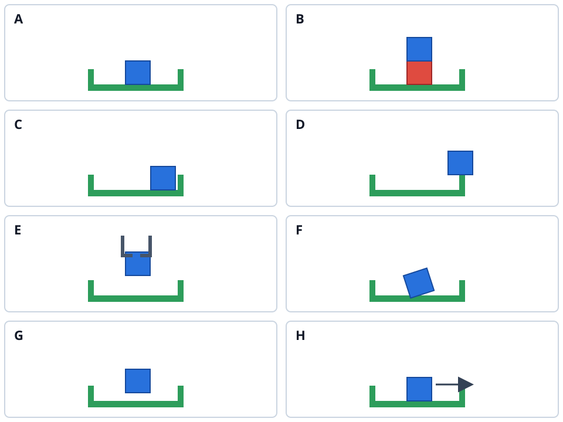

# 终态语义盲审包

请只依据下列最终任务指令和示意图作答；每幅图独立判断蓝块是否已完成目标。图是语义测试用的侧面示意，尚不是仿真截图。无需推测机械臂用了什么步骤，也无需判断哪件物体曾被移动。请勿查阅同目录的其他文件、旧实验结果或仿真真值。

> Place the blue cube fully into the single green socket so it rests flat on the socket floor; release it and leave it stable.

| 图 | 完成 / 未完成 / 无法判断 | 理由；哪些细节需要看运动或换视角 |
| --- | --- | --- |
| A完成 |  |  |
| B未完成，红色方框将蓝色方块和底座隔开 |  |  |
| C完成 |  |  |
| D未完成，蓝色方块在凹槽边缘，而不是凹槽内 |  |  |
| E未完成，蓝色方块还没有完全与凹槽接触 |  |  |
| F完成，蓝色方块进入凹槽，只不过角度倾斜 |  |  |
| G未完成，蓝色方块还没有完全与凹槽接触 |  |  |
| H完成，蓝色方块虽然移动，但是始终在凹槽内部 |  |  |

请另写一句你如何理解 `fully into`、`socket floor`、`release`、`stable`；如果认为指令暗示了特定准备动作，也请指出。记录审读日期，以及审读前是否见过此项目的场景真值或模型分数。
