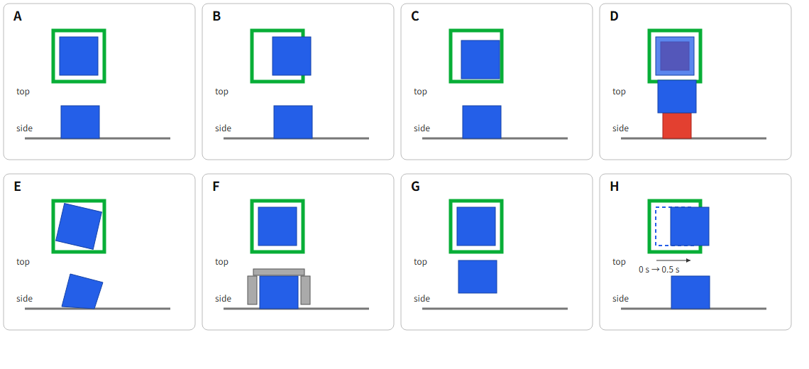

# 平面方框目标：独立终态审读包

请只看本页的最终指令和中性示意图，逐图判断目标是否完成，并写下理由。示意图用于审自然语言，尚非仿真截图；若需要运动或换视角才能判定，请选“无法判断”并指出需要什么证据。请勿查阅同目录其他文件、旧实验、场景尺寸、成功谓词或模型分数。

> Place the blue cube flat on the table entirely inside the single green square, release it, and leave it stable.

图中每格上部为俯视，下部为侧视；灰线是桌面。A–G 显示单一终态，H 显示相隔 0.5 秒的两个姿态。虚线仅表示较早姿态。

| 图 | 完成 / 未完成 / 无法判断 | 理由；需要补看的运动或视角 |
| --- | --- | --- |
| A完成；蓝色方块停在正中心                |  |  |
| B没完成；蓝色方块压住绿色边界 |  |  |
| C完成；蓝色方块在绿框之内，只是离边界比较近 |  |  |
| D未完成，蓝色方块下方存在红色方框，不满足任务要求 |  |  |
| E完成，蓝色方块倾斜，不和桌子水平但是在绿框内 |  |  |
| F完成，蓝色方块此时在铝框内，只需夹爪抬起 |  |  |
| G未完成，蓝色方块没有和桌子水平面接触 |  |  |
| H未完成，0.5秒后蓝色方块压住绿色边框 |  |  |

请另写你如何理解 `flat on the table`、`entirely inside`、`release` 和 `stable`；指令是否暗示必须移动某个非目标物或必须先做独立准备步骤？请记录审读日期，以及审读前是否见过本项目真值、完整场景设计或旧模型分数。请保留原答，不根据作者意见回填。
