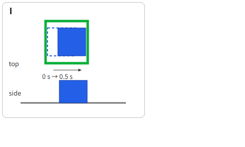

# 终态判断表

请只根据下列英文最终目标句和配图，分别判断 A–I 是否**已经完成**任务。图中每格上部为俯视、下部为侧视；灰线是桌面。A–G 为单一终态，H、I 为相隔 0.5 秒的两个姿态，虚线是较早姿态。图是语言判断用的示意，不是仿真截图。若看不出支撑、释放或静止，请选“无法判断”并写明需要哪种额外画面。不要推测机器人此前做过什么。

> Place the blue cube entirely inside the single green square with one whole face flat against the tabletop. Open the gripper and move it clear, then let the cube settle and stay still.

| 图 | 已完成 / 未完成 / 无法判断 | 一句话理由；如需额外画面请说明 |
| --- | --- | --- |
| A已完成 |  |  |
| B未完成，方块压住边界了 |  |  |
| C已完成 |  |  |
| D未完成，红色方块阻止蓝色方块与桌子接触 |  |  |
| E未完成，方块倾斜，没有稳定停在桌子上 |  |  |
| F未完成，夹爪还没有和蓝色方块分离，蓝色方块的状态仍不稳定 |  |  |
| G未完成，蓝色方块没有和桌子接触 |  |  |
| H未完成，移动后蓝色方块压住绿色边框 |  |  |
| I未完成，物体仍在移动，并不是静止的稳定的状态 |  |  |

最后请写：

1. 你如何理解 `one whole face flat against the tabletop`、`move it clear`、`settle and stay still`？
2. 这句目标是否暗示必须移动某个其他物体，或必须先做一个独立准备步骤？
3. 审读日期与时间；你此前是否看过本项目场景设计、真值、作者预期答案或模型分数？若看过，请说出哪一种。

请保留第一次作答，不根据讨论更改答案。
