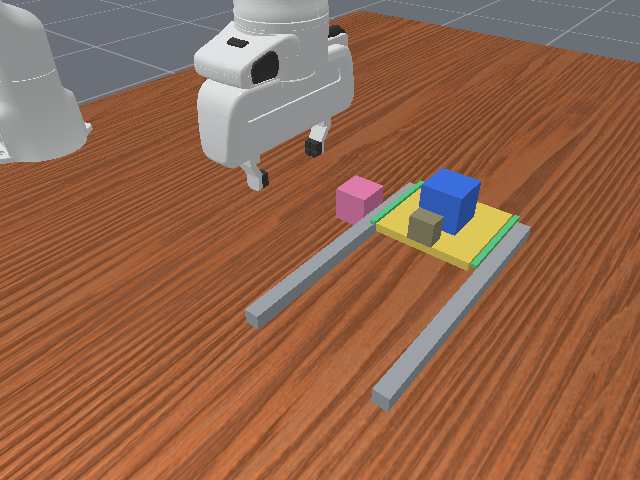
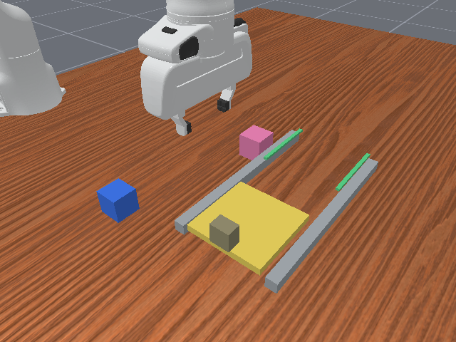

# B：滑入目标位的承托板（dev_v2）

**最终目标原句**：`Place the blue cube on the marked elevated landing, release it, and leave it stable.`

## 合格与不合格终态示意

合格终态原始采样帧：

阻挡态不合格终态原始采样帧：

```text
合格：蓝块完整处于标记区内，底面平贴已部署的黄色板，夹爪离开并静稳。
            [蓝块]
       ═══黄色承托板═══  z=0.120 m
       |             |
       |  桌面在下方 |

不合格：蓝块在桌面、导轨或标记边；部分越出目标区；靠夹爪扶持；
        黄色板仍停在前方，目标下没有合格的高位承托面。
```

黄色板沿两条灰色导轨，从前方停车位滑入后方绿色标记位置。绿色标记是边界提示，不是能托住目标物的中央平台。收起时目标区下方只有低处桌面；蓝块无法在规定高位静稳落放。展开后动态蓝块可由板真实接触承托。板收回时目标物若已在上方会失去该承托；本版主条件 H 从空的开放态出发。

## 尺寸、动作与可见信息

- 蓝块边长 46 mm；目标中心 `(0.16, 0.08)` m；目标承托面 `z=0.120` m；合格中心区域半宽 45 mm；板半宽 55 mm。
- 两条导轨位于目标中心左右 70 mm，内边界在中心左右 62 mm，不能在中心合格足迹下托住蓝块。板停车中心 `y=-0.100` m，展开中心 `y=0.080` m；无效单程仅前移 30 mm，仍远离目标区。
- 可用动作：机械臂沿导轨操作承托板、抓放蓝块、操作粉色无关件、静止。板和把手由预设运动共同驱动，机械臂轨迹同步；这不证明自由动力学抓板能力。
- 模型可见：同一主视角中板、目标标记、蓝块、轨道、动作及终态；只输入最终目标句与 15 帧 1 FPS 视频。
- 仅评分侧：精确位置、全部仿真状态、真实接触、速度、条件映射、续行结果及搜索记录。

## 最强替代路线挑战

检查将蓝块放在导轨/绿色标记上、倾斜靠边、用夹爪扶持、在低桌面稳定后误判高位。完整足迹和目标高度、板接触、无其他上托接触共同排除这些情况。静态几何断言收起状态目标完整足迹下的高位承托面积为零；仿真接触记录需再核查这条断言。主动搜索未找到反例不等于数学证明。抓蓝块时顺带推动板仍可能合法，故只能说部署状态必要，不能说独立展开动作必要。

终态谓词与反例测试见 `experiments/prerequisite_probe/fresh_prerequisite/contract.py` 和 `experiments/prerequisite_probe/tests/test_fresh_prerequisite_contract.py`。该卡在任何新模型结果之前固定。
